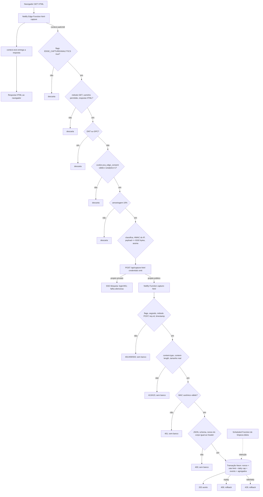
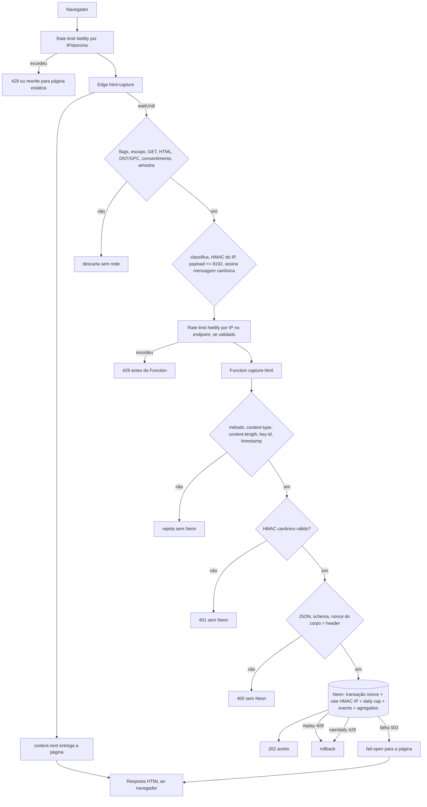

# Fase 5F.1.3 — Projeto de proteção contra abuso e decisão arquitetural

Status: **investigação e projeto concluídos; nenhuma implementação funcional, deploy ou ativação**.
Data: 2026-11-11.
Branch: `feat/portal-analytics`.
Commit de referência durante toda a fase: `8d455fc4f01f7944f2a015681dd5c81c0704d786`.

A Fase 5F.2 **não** foi iniciada. Nenhuma validação remota foi executada.

---

## A. Resumo executivo

**Resultado:** o fluxo atual está tecnicamente consistente, mas ainda não está preparado para
validação remota. O ponto mais importante não é a criptografia: é **quantas vezes a Function é
invocada antes de qualquer decisão de rejeição** e **onde o rate limit é aplicado**.

**Decisão recomendada:** **Alternativa B — endpoint público de ingestão protegido por HMAC —
com uma camada de rate limiting nativo da Netlify por IP antes da Function**, mantendo a
homologação privada para testes de página, consentimento e flags, e usando um **alvo público
autorizado** para o teste ponta a ponta Edge → Function.

**Por que não B “puro”:** o endpoint público com HMAC impede falsificação, mas não impede
invocações inválidas. Em volume, cada POST inválido ainda consome uma invocação de Function,
web request e compute. O rate limit nativo da Netlify é a única proteção de plataforma disponível
no Free para reduzir isso antes da invocação, mas ele é **por IP e por domínio**, não global, e
tem atraso de até 10 s.

**Por que não C agora:** Netlify Blobs mantém a homologação privada, mas adiciona consistência
eventual/forte, atraso de ingestão, idempotência, limpeza, função agendada e custo de Blobs cuja
conversão em créditos não é publicada. É uma alternativa válida de contingência, não a primeira
escolha.

**Principais riscos:**

1. **Crítico:** projeto privado não permite Edge → Function sem bypass de SSO documentado.
2. **Médio:** não há rate limit antes do HMAC; invalidações custam Function.
3. **Médio:** rate limit nativo no Free é apenas por IP/domínio, sem limite global, com atraso.
4. **Médio:** CPU real do Edge, `waitUntil`, `AbortSignal.timeout`, WebCrypto, bundler real e
   latência Ohio → São Paulo não foram medidos.
5. **Médio:** timeout de 2000 ms é hipótese.
6. **Médio:** integração PostgreSQL não foi executada nesta fase.
7. **Baixo:** HMAC não identifica pessoas nem prova consentimento; é autenticação de serviço.

**Bloqueios restantes:** escolha formal do alvo público de validação; teste real do rate limit
nativo (incluindo o efeito sobre chamadas internas Edge → Function); validação de runtime;
integração PostgreSQL; confirmação do saldo de créditos pelo usuário.

---

## B. Estado inicial do repositório

| Item | Valor |
|---|---|
| Diretório | `D:\Projetos\Site Calculadora` |
| Branch | `feat/portal-analytics` |
| Commit | `8d455fc4f01f7944f2a015681dd5c81c0704d786` |
| Divergência do commit informado | Nenhuma |
| `git status --short` inicial | 255 entradas (alterações das fases anteriores preservadas) |
| `git status --short` final | 256 entradas (255 + este relatório) |
| Operações destrutivas | Nenhuma |

Arquivos e documentos consultados:

- `docs/analytics/fase-5f-1-2-auditoria-independente.md`
- `docs/analytics/fase-5f-1-1-investigacao.md`
- `docs/analytics/fase-4-plano.md`, `fase-4-decisoes.md`, `fase-4-implementacao.md`,
  `fase-4-homologacao.md`, `fase-4-lia.md`
- `docs/analytics/fase-2.md`, `fase-3.md`
- `netlify/edge-functions/html-capture.js`
- `netlify/edge-functions/_lib/edge-capture.mjs`
- `netlify/edge-functions/_lib/capture-policy.mjs`
- `netlify/edge-functions/_lib/capture-limits.mjs`
- `netlify/edge-functions/_lib/capture-signature.mjs`
- `netlify/edge-functions/_lib/edge-env.mjs`
- `netlify/edge-functions/_lib/classifier.mjs`
- `netlify/functions/capture-html.mjs`
- `netlify/functions/_lib/capture-handler.mjs`
- `netlify/functions/_lib/capture-validation.mjs`
- `netlify/functions/_lib/capture-config.mjs`
- `netlify/functions/_lib/db.mjs`, `http.mjs`
- `js/analytics.js`
- `db/migrations/003_phase4_html_capture.sql`
- `tests/analytics/*.mjs`, `tests/e2e/consent.spec.js`
- `netlify.toml`, `package.json`, `.env.example`, `.gitignore`

Não foram encontrados `rateLimit`, `rate_limit`, `windowLimit` ou `aggregateBy` no código ou no
`netlify.toml` atual.

Verificação local não destrutiva nesta fase: `npm run test:analytics` = **72 aprovados, 0 falhas**;
as suítes `capture.integration` e `collect.integration` foram skipped por ausência de
`TEST_DATABASE_URL`. Nenhum código funcional foi alterado nesta fase.

---

## C. Fluxo atual



### Onde cada proteção ocorre e o que já foi consumido

| Etapa | Proteção | Recurso já consumido antes da decisão |
|---|---|---|
| Netlify CDN/DDoS | Proteção DDoS de rede padrão da plataforma | Nenhum código do projeto |
| Rate limit nativo | **Inexistente hoje** | — |
| Edge `html-capture` | flags, escopo, método, HTML, DNT/GPC, cookie, amostragem | Invocação da Edge e web request da página |
| Edge payload | classificação, HMAC do IP, limite de 8192 bytes, assinatura canônica | CPU do Edge, inclusive dentro de `waitUntil` |
| `fetch` interno | `credentials: 'omit'`, `redirect: 'error'`, `AbortSignal.timeout` | Nova requisição de rede e, em projeto público, invocação da Function |
| Function antes do HMAC | flags, segredo, método, key-id, timestamp, content-type, content-length, tamanho real | Invocação da Function, leitura de cabeçalhos/corpo e web request |
| Function no HMAC | HMAC-SHA256 canônico e comparação em tempo constante | CPU da Function; **nenhuma consulta ao Neon** |
| Function no schema | JSON, Zod, nonce, `captured_at` | CPU da Function; **nenhuma consulta ao Neon** |
| Neon | nonce/replay, rate limit por `rate_key`, limite diário, evento, agregados | Conexão e transação no Neon; só ocorre após HMAC e schema |
| Scheduled Function | limpeza por retenção | Compute agendado e transação no Neon |

**Ponto central:** hoje, uma requisição externa inválida pode invocar a Function, ler o corpo e
calcular HMAC antes de ser rejeitada. Ela não grava no Neon, mas consome invocação, tempo de
Function e web request. O rate limit atual só existe **depois** do HMAC e do schema, dentro da
transação, portanto protege o banco e o volume de eventos válidos, não a invocação.

---

## D. Modelo de ameaças

Probabilidade qualitativa considera exposição e facilidade; não há dados estatísticos suficientes
para probabilidade numérica.

| # | Ameaça | Prob. | Impacto | Controle existente | Controle ausente | Risco residual | Mitigação recomendada |
|---|---|---|---|---|---|---|---|
| A1 | Enxurrada de POSTs sem HMAC válido no endpoint público | Alta se público | Médio: invocações, CPU e web requests | HMAC, método, content-type, tamanho | Rate limit antes da Function | Médio | Rate limit nativo por IP + limite de superfície + monitoramento |
| A2 | Corpos grandes ou ausentes com `Content-Length` mentiroso | Média | Médio: leitura de até 6 MB na plataforma | Checagem declarada e real de 8192 | Rejeição de `Content-Length` ausente/transferência chunked antes da leitura | Médio | Requerer tamanho declarado válido; testar no Edge/Function |
| A3 | Cabeçalhos malformados ou duplicados | Média | Baixo: rejeição | `Headers.get`, regex, HMAC canônico | Nenhum específico | Baixo | Manter rejeição; testes de duplicidade |
| A4 | Consumo criptográfico por invalidações | Alta se público | Médio: CPU de HMAC | HMAC só depois de tamanho/key-id/timestamp | Rate limit pré-HMAC | Médio | Rate limit nativo; HMAC é barato mas não infinito |
| B1 | Replay de nonce | Média | Médio: duplicidade/contagem | PK do nonce na transação, timestamp assinado | Teste real de concorrência nesta fase | Baixo | Validação PostgreSQL de replay concorrente |
| B2 | Alteração de corpo, timestamp, nonce ou key-id | Média | Alto: falsificação | HMAC cobre os quatro; comparação constante | Nenhum comprovado | Baixo | Manter testes; rotação de chave futura |
| B3 | Cabeçalhos duplicados/canonicalização divergente | Baixa | Médio: rejeição ou ambiguidade | `Headers.get` e mensagem canônica compartilhada | Teste de runtime real | Baixo | Testes de integração e fuzzing local |
| B4 | Reuso de requisição válida capturada | Baixa | Médio: evento duplicado | Nonce, timestamp assinado, replay 409 | Não validado com banco nesta fase | Baixo | Integração PostgreSQL |
| C1 | Invalidação distribuída por muitos IPs | Média | Alto: custo e disponibilidade | DDoS padrão da Netlify; HMAC | Limite global no Free; WAF é Enterprise | Alto se atacante dedicado | Rate limit por IP + limite diário + alertas; aceitar risco residual no Free |
| C2 | Bots de baixo volume e lento | Média | Baixo/médio | HMAC, consentimento e amostragem | Detecção comportamental | Médio | Monitorar; não criar fingerprinting |
| C3 | Múltiplas regiões e proxies | Média | Médio | Nenhum específico | Rate limit global | Médio | Rate limit por IP e resposta uniforme |
| D1 | Exaustão de invocações de Function | Alta se público | Alto: créditos e pausa do site | HMAC, limite diário só no banco | Rate limit pré-Function | Alto em volume alto | Rate limit nativo; testar custo |
| D2 | CPU do Edge por página | Média | Médio: 50 ms por invocação | Amostragem after edge; payload pequeno | Rate limit de página | Médio | Rate limit de Edge path; medir CPU |
| D3 | Consultas/conexões Neon | Baixa | Médio | HMAC antes do banco; pool max 1; transação curta | Rate limit pré-HMAC não evita DB porque não há DB antes do HMAC | Baixo | Manter HMAC antes do banco; testar concorrência |
| D4 | Crescimento de nonces/rate limits | Média com tráfego válido | Baixo/médio | Retenção 24 h; daily cap 25k; cleanup | Rate limit global no Free | Baixo | Monitorar e validar cleanup |
| D5 | Execuções excessivas de cleanup | Baixa | Baixo | Cron diário; 30 s | Nenhum | Baixo | Medir com volume de teste |
| E1 | NAT/IP compartilhado e rate limit por IP | Alta em redes compartilhadas | Médio: falsos 429 | Nenhum | Threshold adequado | Médio | Limite generoso, monitorar e permitir rewrite |
| E2 | IP móvel variável | Alta | Baixo: bypass do rate limit | Nenhum | — | Baixo | Aceitar; HMAC/daily cap continuam |
| E3 | Privacidade do navegador/DNT/GPC | Média | Baixo: menos dados | DNT/GPC bloqueiam | — | Baixo | Manter |
| E4 | Picos legítimos | Média | Médio: 429 | Nenhum | Capacidade/limite | Médio | Testar limites; alertas; ação rewrite |
| E5 | Retirada de consentimento | Média | Baixo | Cookie analytics=0 e DNT/GPC | — | Baixo | Manter e testar |
| E6 | Preview/monitoramento | Média | Baixo | Classificação; sem cookie geralmente | — | Baixo | Manter classificação, sem bloquear |

**Observação:** o HMAC não identifica uma pessoa, não prova consentimento e não impede custo de
requisições inválidas. Ele apenas prova conhecimento do segredo compartilhado.

---

## E. Comparação de rate limiting

### Alternativa 1 — Contador em memória local na Edge

- **Como seria:** um `Map` por isolate, atualizado no handler.
- **Vantagens:** custo de CPU baixo; sem rede; pode cortar rajadas locais.
- **Desvantagens:** não é compartilhado entre isolates, regiões ou reinicializações; o atacante
  escala horizontalmente e o limite “reinicia”; não há garantia de afinidade; não serve como
  limite global.
- **Custo:** mínimo de CPU, mas dentro do orçamento de 50 ms.
- **Privacidade:** poderia usar IP em memória, mas sem persistência; ainda assim não é confiável.
- **Recomendação:** **não usar como rate limit principal**. No máximo, proteção oportunista e
  descartável, sem prometer limite.

### Alternativa 2 — Rate limit na Function antes do HMAC

- **Como seria:** usar `context.ip` (documentado para Functions) e uma tabela no Neon, com HMAC do
  IP por segredo separado, antes do HMAC da mensagem.
- **Vantagens:** cobre chamadas diretas à Function; usa IP confiável da plataforma; pode ser
  atômico no banco.
- **Desvantagens:** a Function já foi invocada; não elimina o custo inicial; cada requisição
  inválida passaria a abrir conexão e fazer escrita/consulta no Neon; uma enxurrada poderia
  esgotar pool/conexões e prejudicar a ingestão válida; a tabela de rate limit vira alvo de
  crescimento; exige retenção, TTL e role separada; ainda permite escrita não autenticada.
- **Custo:** pior que o modelo atual para abuso: adiciona DB a requisições inválidas.
- **Privacidade:** IP bruto não persistido se usar HMAC; porém aumenta a superfície e a
  correlação.
- **Recomendação:** **não como primeira camada**. Pode ser segunda camada futura, com tabela
  separada, HMAC de IP, TTL curto e limite estrito, somente se o rate limit nativo não bastar.

### Alternativa 3 — Serviço externo especializado

- **Opções citadas:** Cloudflare, Upstash/Redis ou similar.
- **Situação:** nenhum serviço está conectado ao projeto; não há credenciais; não há autorização
  para contratar; planos gratuitos e limites precisam ser verificados caso a caso; há impacto de
  privacidade, latência e dependência externa.
- **Vantagens:** rate limit global/distribuído, se configurado corretamente.
- **Desvantagens:** nova conta, novo segredo, novo DPA/privacidade, possível cobrança inesperada,
  complexidade de integração no Edge, latência adicional no caminho crítico.
- **Recomendação:** **não nesta fase**. Só avaliar com autorização explícita, orçamento e revisão
  de privacidade. Não assumir que um plano gratuito é suficiente para produção.

### Alternativa 4 — Controles nativos da Netlify

Fatos oficiais relevantes:

- **Rate limiting code-based** está disponível em **todos os planos**; no Free são **2 regras por
  projeto**; agregação **por domínio e IP** (não há agregação global no Free); ação de bloquear
  (429) ou reescrever; enforcement pode atrasar até **10 s**; conta depois de DDoS, Firewall e WAF.
- **Firewall Traffic Rules**: no Free, **2 regras**, até **3 IPs** e **3 geolocalizações** por
  regra; útil para blocklist estática, não para taxa dinâmica.
- **WAF**: disponível apenas em **Enterprise com High-Performance Edge**.
- **DDoS**: proteção de rede padrão em todos os planos.
- **Rate limiting de UI** (por header, cookie, CIDR, geolocalização) é Enterprise; no Free só
  code-based por path.
- **Aplicação:** o rate limiting code-based pode ser declarado no `config` de Edge Function,
  Function ou redirect. A regra é validada no pós-processamento do deploy.

**Vantagens:** sem terceiro, nativo, sem segredo novo, compatível com Free, reduz invocações se
aplicado antes da Function.

**Desvantagens:** por IP, não global; atraso de até 10 s; não cobre IPs rotativos; no Free há só
2 regras; a interação com `excludedPath` e com a chamada interna Edge → Function precisa ser
testada; a regra na Function pode contar o IP de egress da Edge, não o visitante.

**Recomendação:** **usar como primeira camada**, com limites generosos e teste em alvo público.
Não apresentar como limite absoluto.

### Limites de confiança do HMAC

Como o segredo não está no navegador, uma requisição externa sem o segredo **não consegue** produzir
assinatura válida. O problema de abuso não é falsificação bem-sucedida; é o custo de tentativas
inválidas e a possibilidade de comprometimento do segredo.

**O que o HMAC garante:**

- que a mensagem canônica foi produzida por quem conhece o segredo compartilhado;
- integridade de versão, `key-id`, timestamp, nonce e corpo;
- autenticidade de serviço entre Edge e Function (não de usuário);
- com timestamp assinado e nonce transacional, resistência a replay dentro da janela.

**O que o HMAC não garante:**

- identidade, consentimento, intenção ou autorização de uma pessoa;
- confidencialidade do payload (ele trafega no corpo; a proteção é TLS entre as partes);
- proteção contra custo de requisições inválidas — o HMAC só decide validade;
- resistência se o segredo vazar; nesse caso, um atacante pode forjar eventos, escolher `rate_key`
  arbitrário e consumir o limite diário;
- que `Origin`, `Referer`, User-Agent, `Sec-Fetch-*` ou qualquer header do cliente sejam
  autenticação. Eles são controlados pelo cliente e não devem ser usados como prova.

**Mitigações de confiança já presentes:** segredo separado por ambiente, mínimo de 32 bytes UTF-8,
allowlist no Edge, HMAC antes de JSON/banco, comparação em tempo constante, timestamp e nonce
assinados, limite diário, rate limit por rate key e ausência do segredo no navegador/HTML/respostas.

**Evolução possível, não implementada:** assinatura assimétrica (por exemplo, Ed25519 ou ECDSA
P-256) com chave privada no Edge e chave pública na Function, `key-id` para rotação. Isso reduz a
exposição do segredo de verificação na Function, mas não elimina o custo de invalidação nem prova
consentimento; é uma decisão separada, com complexidade e testes próprios.

### Privacidade do rate limiting

- O rate limit nativo da Netlify usa IP na plataforma; o código do projeto não precisa persistir IP
  bruto.
- O rate limit de aplicação existente persiste apenas `HMAC-SHA256(IP, EDGE_INGEST_SECRET)` como
  `bucket_key`, janela e contador; o IP bruto não é armazenado no evento.
- A retenção de `edge_rate_limits` é curta (24 h no cleanup padrão) e a tabela não é ligada a
  `visitor_id` ou `session_id`.
- IP compartilhado/NAT pode gerar falso positivo; o limite precisa ser generoso e monitorado.
- IP móvel pode rotacionar e escapar do limite; isso é aceito, e o HMAC/limite diário continuam.
- Rotação do segredo de HMAC do IP muda todos os buckets; deve ser rara e planejada, com janela de
  transição ou reset documentado.
- Não usar fingerprinting, UA, headers de navegador ou identificador persistente para rate limit.
  Não coletar dado adicional apenas para “melhorar” a classificação de bots.

### Blobs como contador compartilhado?

Blobs é um armazenamento compartilhado disponível no Free e tem escritas condicionais
(`onlyIfNew`/`onlyIfMatch`), mas não é um contador atômico de alta concorrência, não tem região São
Paulo, a consistência padrão é eventual (60 s) e a conversão de uso em créditos não é publicada.
Por isso, **não é recomendado como contador de rate limit no caminho crítico** sem um protótipo e
uma decisão de custo/consistência.

### Alternativa 5 — Reduzir a superfície pública

Já implementado:

- Function aceita apenas POST.
- Exige `application/json`.
- Limita corpo a 8192 bytes e confere tamanho declarado e real.
- Verifica key-id, timestamp, HMAC antes de JSON/schema e antes do banco.
- Respostas genéricas, sem segredo.
- Edge só processa GET, caminhos públicos, resposta HTML, consentimento e amostra.
- Edge não lê o corpo da resposta; `credentials: 'omit'`; sem cookies de autenticação.

Propostas adicionais de baixo custo, **não implementadas**:

- exigir `Content-Length` válido e rejeitar transferência sem tamanho declarado;
- limitar o comprimento de cabeçalhos antes de qualquer trabalho;
- manter HMAC e schema antes de qualquer escrita;
- não adicionar CORS amplo, não usar `Origin`/`Referer`/UA como autenticação;
- não criar endpoint alternativo público.

**Efeito:** reduz custo por requisição inválida e chance de aceitar lixo; **não** reduz o número de
invocações. O rate limit nativo é o que reduz invocações.

### Recomendação de rate limiting

**Duas camadas:**

1. **Plataforma Netlify (code-based, por IP):**
   - regra no caminho da Edge Function de captura/páginas, para reduzir rajadas de páginas e,
     consequentemente, trabalho da Edge e da Function;
   - regra no caminho da Function `/api/capture-html`, se o teste comprovar que a chamada interna
     não é prejudicada; começar com limite alto e medir.
   - Limites iniciais candidatos (a validar, não definitivos): **120 requisições/60 s por IP** para
     páginas e **60–120 requisições/60 s por IP** para a Function; ajustar após medir NAT e tráfego
     legítimo. Ação inicial: `429` ou `rewrite` para página estática.
2. **Aplicação (já existente, após HMAC):** rate limit por `rate_key` HMAC do IP, limite diário
   global, nonce/replay, corpo máximo, timeout e sem retry.

**Não usar** contador em memória como limite global. **Não usar** tabela Neon antes do HMAC como
primeira camada. **Não contratar** serviço externo sem autorização.

---

## F. Comparação arquitetural

### Alternativa B — endpoint público protegido por HMAC

Fluxo: Navegador → Edge → Function pública → HMAC/replay/rate limit → Neon.

| Dimensão | Avaliação |
|---|---|
| Simplicidade | Alta; é o fluxo atual, com rate limit nativo e alvo público |
| Compatibilidade com produção | Alta; produção é pública |
| Compatibilidade com homologação privada | **Baixa**; Edge → Function não atravessa SSO |
| Exposição | Endpoint público, mas HMAC + limites |
| Custo de invocação | Existe; reduzível com rate limit nativo, não eliminável |
| Proteção contra abuso | Média; per-IP no Free, sem limite global |
| Dependência do HMAC | Alta; HMAC é a autenticação de serviço |
| Testabilidade | Alta em alvo público; baixa em privado |
| Privacidade | Boa; sem cookies de auth, sem IP bruto persistido, sem UA bruto |

### Alternativa C — Netlify Blobs + Scheduled Function

Fluxo possível: Navegador → Edge → Blob temporário → Scheduled Function → validação → Neon.

Fatos oficiais relevantes:

- Blobs está disponível no Free (armazenamento de blob incluído no plano), mas **consome o pool
  compartilhado de créditos**; a Netlify não publica uma tarifa separada por GB/operação para Blobs.
- Consistência padrão é **eventual**, com propagação de atualizações/exclusões em até **60 s**;
  consistência **forte** é opcional e tem leitura mais lenta.
- Store site-wide usa **`us-east-2` (Ohio)** por padrão; as regiões suportadas para Blobs são
  `us-east-1`, `us-east-2`, `eu-central-1`, `ap-southeast-1` e `ap-southeast-2`. **Não há São
  Paulo.** Store deploy-specific herda a região da Function.
- Objeto individual até **5 GB**; metadata até **2 KB**; chaves até 600 bytes; store até 64 bytes.
- Escritas condicionais `onlyIfNew`/`onlyIfMatch` existem, mas não são um contador atômico de alta
  concorrência.
- Scheduled Function tem limite de execução de **30 s** e roda por cron; falhas exigem retry,
  idempotência e limpeza.
- O Blob não é público; acesso é pelo site; dados são criptografados em repouso/trânsito.
- É possível manter a homologação privada, porque não há ingresso HTTP público.
- O Edge escreve no Blob e uma Scheduled Function lê e grava no Neon; há atraso e possibilidade de
  duplicidade/reprocessamento.
- Custo de Blobs não é itemizável com os dados públicos atuais; não é possível estimar créditos com
  precisão.

| Dimensão | Avaliação |
|---|---|
| Simplicidade | Baixa/média; nova fila, scheduled, idempotência, limpeza |
| Compatibilidade com homologação privada | Alta |
| Compatibilidade com produção pública | Alta, mas adiciona atraso |
| Exposição | Não expõe endpoint de ingestão |
| Custo | Blobs + scheduled compute + leitura/escrita; conversão em créditos não publicada |
| Proteção contra abuso | Melhor no ingresso HTTP; porém escrita em Blob ainda pode ser abusada por cookie forjado |
| Consistência | Eventual 60 s ou forte; risco de leitura atrasada |
| Testabilidade | Média; mais partes móveis |
| Privacidade | Boa, mas o payload fica temporariamente em Blob; exige retenção/limpeza |

### Alternativa adicional — B com alvo público dedicado

Não é uma nova topologia de dados; é uma **estratégia de validação**: manter a homologação privada
para página/consentimento/flags e validar Edge → Function em um site ou branch público autorizado,
com flags falsas primeiro e dados sintéticos. É a forma de menor complexidade para validar B sem
tornar a homologação pública e sem repassar SSO.

### Justificativa da escolha

**B + rate limit nativo + alvo público dedicado** é a melhor relação entre simplicidade,
testabilidade, privacidade e custo no plano Free. C só se justifica se for proibido usar qualquer
alvo público para validação ou se o endpoint público for inaceitável mesmo com HMAC. A escolha de C
deve ser tratada como decisão arquitetural separada, com orçamento e validação de Blobs.

---

## G. Custos

### Tarifas oficiais usadas

- Free: **300 créditos/mês**, limite rígido, sem recarga; ao esgotar, os projetos pausam.
- Deploy de produção: **15 créditos** por deploy; Deploy Preview/branch: **0**.
- Web requests: **2 créditos por 10.000** requests, incluindo Edge Functions, API Functions e
  assets.
- Compute de Function: **10 créditos por GB-hora**; Edge não entra em compute.
- Function padrão: **1024 MB**, limite síncrono **60 s**.
- Saldo de **141,9 créditos** é **histórico informado**, não saldo atual garantido.
- Ciclo informado: 31/10 a 30/11/2026; não consultado nesta fase.
- Function padrão em `cmh` (Ohio); seleção de região de Function é recurso Pro/Enterprise. No Free
  não é possível mover a Function para `gru` (São Paulo).
- O Neon de homologação está em `aws-sa-east-1` (São Paulo), conforme confirmado na fase anterior;
  não foi reconsultado nesta fase.

### Fórmulas

Sejam:

- `R` = requisições HTML/dia que executam a Edge;
- `c` = fração com consentimento/escopo válido (use 1,0 para limite superior);
- `s` = 0,10 (amostragem);
- `V = R × c × s` = capturas válidas/dia;
- `A` = requisições inválidas/dia diretamente na Function;
- `F = V + A` = invocações da Function/dia;
- `d` = duração média da Function em segundos.

Créditos mensais aproximados:

```
Edge web requests         = 0,006 × R        (2 créditos/10k × 30 dias)
Function web requests     = 0,006 × F
Function compute          = 0,083333 × F × d  (10 créditos/GB-h × 1 GB × 30 dias / 3600)
Total captura/Function    = 0,006F + 0,083333Fd
Total site aproximado     = 0,006R + 0,006F + 0,083333Fd
Escritas Neon por mês     ≈ 30 × V × 6 (evento + 2 agregados + nonce + rate + daily)
```

`d = 0,05 s` (50 ms) é **hipótese conservadora** para a tabela; cold start pode ser maior.

### Cenário com capturas válidas, sem invalidação extra (`A = 0`, `c = 1`, `s = 0,1`, `d = 50 ms`)

| Edge req./dia | Capturas válidas/dia | Function inv./dia | Web Function (créditos/mês) | Compute Function (créditos/mês) | Captura total (créditos/mês) | Edge páginas (créditos/mês) | Total site aprox. | Escritas Neon/mês |
|---:|---:|---:|---:|---:|---:|---:|---:|---:|
| 1.000 | 100 | 100 | 0,60 | 0,42 | 1,02 | 6,00 | 7,02 | 18.000 |
| 10.000 | 1.000 | 1.000 | 6,00 | 4,17 | 10,17 | 60,00 | 70,17 | 180.000 |
| 100.000 | 10.000 | 10.000 | 60,00 | 41,67 | 101,67 | 600,00 | 701,67 | 1.800.000 |
| 1.000.000 | 100.000 | 100.000 | 600,00 | 416,67 | 1.016,67 | 6.000,00 | 7.016,67 | 18.000.000 |

**Leitura:** 10.000 páginas/dia já custam cerca de 70 créditos/mês só entre página e captura;
100.000/dia estouram os 300 créditos apenas com web requests de página. A 1M/dia é inviável no Free.

### Sensibilidade a invalidação distribuída (`A = R`, `c = 1`, `s = 0,1`, `d = 50 ms`)

| Edge req./dia | Válidas/dia | Inválidas/dia | Function inv./dia | Web Function | Compute | Captura total | Edge páginas | Total site |
|---:|---:|---:|---:|---:|---:|---:|---:|---:|
| 1.000 | 100 | 1.000 | 1.100 | 6,60 | 4,58 | 11,18 | 6,00 | 17,18 |
| 10.000 | 1.000 | 10.000 | 11.000 | 66,00 | 45,83 | 111,83 | 60,00 | 171,83 |
| 100.000 | 10.000 | 100.000 | 110.000 | 660,00 | 458,33 | 1.118,33 | 600,00 | 1.718,33 |
| 1.000.000 | 100.000 | 1.000.000 | 1.100.000 | 6.600,00 | 4.583,33 | 11.183,33 | 6.000,00 | 17.183,33 |

**Leitura:** um atacante que consiga o mesmo volume de invalidações que o tráfego legítimo
multiplica o custo de captura/Function por ~11x (10,17 → 111,83 no cenário de 10 mil páginas/dia);
no total do site o aumento é ~2,4x porque o tráfego de página domina. Se a duração for 10 ms, o
compute cai ~5x, mas web requests continuam; o risco não desaparece. O rate limit nativo por IP
reduz volume, mas não elimina ataque distribuído.

### Invalidação pura (sem tráfego legítimo, `d = 50 ms`)

| POSTs inválidos/dia | Web requests/mês | Compute/mês | Total/mês |
|---:|---:|---:|---:|
| 1.000 | 6,00 | 4,17 | 10,17 |
| 10.000 | 60,00 | 41,67 | 101,67 |
| 100.000 | 600,00 | 416,67 | 1.016,67 |
| 1.000.000 | 6.000,00 | 4.166,67 | 10.166,67 |

### Custos não estimáveis com os dados públicos

- Duração real e cold start da Function no runtime Netlify.
- Proporção real de requisições inválidas e distribuição de IPs.
- Bandwidth incremental da captura (request/resposta pequenos; grande parte do tráfego de página já
  existe independentemente da captura).
- Consumo exato de Blobs na Alternativa C: a Netlify diz que Blobs consome créditos, mas não publica
  tarifa separada por GB/operação.
- Neon: não consome créditos Netlify; está sujeito ao plano Neon Free (100 CU-h/projeto/mês, 1 GB de
  storage/projeto, 5 GB de egress/projeto, scale-to-zero após 5 min). O custo real depende das
  consultas e do volume retido; não foi medido.
- Limpeza agendada: 30 execuções/mês, limite de 30 s; estimativa **< 0,1 crédito/mês** em compute,
  sujeita a medição.
- Deploy de validação: 15 créditos por deploy de produção; 0 para branch/Deploy Preview; a mudança
  de variáveis exige novo deploy.

### Conclusão de custo

Para o volume provável de um portal em crescimento, a faixa de **10.000 a 30.000 páginas/dia** já
consome uma parcela relevante dos 300 créditos (aproximadamente 70 a 210 créditos/mês só entre
página e captura, antes de assets, bandwidth, deploys e outras funções). Acima disso, mesmo sem
abuso, a conta pode esgotar o plano. O risco financeiro maior não é o Neon: é **invocação de
Function + web requests** causada por tráfego de página e por invalidações. O rate limit nativo é
obrigatório antes de qualquer teste de volume; o orçamento precisa de teto explícito e
monitoramento.

---

## H. Arquitetura final proposta



### Fluxo de validação e responsabilidades

1. **Plataforma Netlify:** aplica DDoS padrão e, quando configurado, rate limit code-based por IP.
   Não identifica pessoas e não é um limite global no Free. Enforcement pode atrasar 10 s.
2. **Edge:** decide se a página é elegível e se há consentimento; classifica; calcula HMAC do IP;
   monta payload; assina; agenda envio. Não lê o corpo da resposta. Falha nunca bloqueia a página.
3. **Function:** valida método, content-type, tamanho, key-id, timestamp, HMAC, JSON, schema e
   nonce antes de qualquer banco. Rejeições inválidas não escrevem no Neon.
4. **Neon:** recebe somente eventos autenticados e válidos; a transação cobre replay, rate, daily
   cap, evento e agregados.
5. **Consentimento:** verificado apenas no Edge, por cookie declarado e DNT/GPC. A Function confia
   no HMAC; HMAC não é consentimento.
6. **Replay:** nonce único assinado, timestamp assinado, PK no banco e transação.
7. **Abuso:** rate limit nativo por IP (primeira camada), rate limit por `rate_key` HMAC e limite
   diário (segunda camada), corpo máximo, timeout, sem retry e resposta 202 estrita.
8. **Fail-open:** `context.next()` imediato, `waitUntil` protegido, erros silenciosos, Function
   genérica; a página continua.
9. **Custo:** amostragem 10%, limite diário, corpo 8 KB, sem retry, `202` apenas, rate limit de
   plataforma, monitoramento e teto de créditos.
10. **Homologação:** privada para página/consentimento/flags; pública e dedicada para o teste
    Edge → Function, ou C se privacidade integral for obrigatória.

### Tabela de componentes

| Componente | Responsabilidade | Proteção aplicada | Dados utilizados | Dados que não devem ser coletados |
|---|---|---|---|---|
| Netlify DDoS/rate limit | Cortar volume e rajadas | DDoS padrão; rate limit code-based por IP | IP de rede (plataforma) | Não persistir IP no app; não usar header do cliente como identidade |
| Edge `html-capture` | Decidir elegibilidade e emitir evento | Flags, escopo, GET, HTML, DNT/GPC, cookie, amostra, limite, HMAC | Caminho, país, headers normalizados, IP só para HMAC, cookie de consentimento | Corpo da resposta, cookies de auth, UA bruto, dados de calculadora, query string |
| `capture-signature` | Canonicalização compartilhada | Versão, key-id, timestamp, nonce, corpo | Metadados do evento | Segredo em log/payload |
| `capture-html` Function | Autenticar e validar | Método, content-type, tamanho, key-id, timestamp, HMAC, Zod, nonce | Payload validado | IP bruto, UA bruto, cookies, valores de calculadora |
| Neon | Persistir e limitar | Nonce, rate HMAC IP, daily cap, agregados, retenção | Evento e agregados aprovados | IP bruto, UA bruto, IDs de visitante da Fase 4 |
| Scheduled cleanup | Expirar dados | Retenção 7/90/13 meses e 24 h | Contadores e datas | Dados de visitante |
| Rate limit nativo | Reduzir invocações | Per IP/domain, 429/rewrite | IP de rede | Nada persistido pelo app |

---

## I. Plano de implementação incremental

Nenhuma etapa abaixo foi iniciada.

### Etapa A — Ajustes locais e testes

- **Objetivo:** consolidar política de rate limit, limites e testes sem mudar o fluxo.
- **Arquivos esperados:** módulos puros de política, testes unitários, documentação.
- **Testes:** limites, HMAC canônico, nonce, timestamp, cookie, payload, timeout, imports.
- **Riscos:** alterar comportamento sem runtime; falsos positivos.
- **Dependências:** nenhuma.
- **Aprovação:** revisão local.
- **Deploy:** não.
- **Créditos:** 0.

### Etapa B — Compatibilidade do bundler

- **Objetivo:** provar que Edge e Function empacotam imports compartilhados.
- **Arquivos esperados:** nenhum funcional; eventual ajuste de import/estrutura.
- **Testes:** build Netlify local/CI, inspeção de artefatos, ausência de secrets.
- **Riscos:** bundler não incluir arquivo fora do diretório; divergência de versão.
- **Dependências:** Netlify CLI ou `zip-it-and-ship-it` local.
- **Aprovação:** artefato inspecionado.
- **Deploy:** não (build local/CI).
- **Créditos:** 0.

### Etapa C — Validação controlada de runtime

- **Objetivo:** medir Edge CPU, `waitUntil`, `AbortSignal`, WebCrypto, Function duration e
  latência até o Neon.
- **Arquivos esperados:** instrumentação temporária sem PII e flags de teste.
- **Testes:** página, captura válida, inválida, timeout, aborto, status 202, falha silenciosa.
- **Riscos:** cold start; região; timeout de 2000 ms; custo.
- **Dependências:** alvo público autorizado; banco de teste; saldo confirmado.
- **Aprovação:** métricas dentro do orçamento e página intacta.
- **Deploy:** sim, no alvo de teste.
- **Créditos:** ~15 por deploy de produção; 0 se branch/preview público; uso < 2.

### Etapa D — Validação de proteção contra abuso

- **Objetivo:** testar rate limit nativo por IP, atraso de 10 s, 429/rewrite, falso positivo e
  efeito na chamada interna Edge → Function.
- **Arquivos esperados:** configuração `rateLimit` no alvo de teste; nenhum ajuste em produção.
- **Testes:** rajadas controladas, IP único, múltiplos IPs, tráfego legítimo, NAT simulado.
- **Riscos:** bloquear chamadas internas; thresholds baixos; bypass distribuído.
- **Dependências:** Etapa C; alvo público; 2 regras Free.
- **Aprovação:** limites documentados, sem bloquear tráfego legítimo, custo medido.
- **Deploy:** sim, no alvo de teste.
- **Créditos:** 15 por deploy; 0 se branch/preview; uso adicional conforme volume.

### Etapa E — Integração PostgreSQL

- **Objetivo:** executar replay, rate limit, daily cap, roles e retenção com banco de teste.
- **Arquivos esperados:** nenhum funcional; configuração de `TEST_DATABASE_URL`.
- **Testes:** `capture.integration.spec.mjs` e `collect.integration.spec.mjs`.
- **Riscos:** conexão remota; dados sintéticos; roles.
- **Dependências:** banco PostgreSQL isolado, nunca produção.
- **Aprovação:** 100% dos testes de integração.
- **Deploy:** não.
- **Créditos:** 0 Netlify; custo Neon de teste separado.

### Etapa F — Estabilidade e custos

- **Objetivo:** medir créditos em 1k/10k páginas/dia e confirmar limites.
- **Arquivos esperados:** nenhum; relatório de métricas.
- **Testes:** carga controlada, pausa, desligamento, limpeza.
- **Riscos:** ultrapassar 300 créditos; pausar o site.
- **Dependências:** Etapas C, D e E; saldo confirmado.
- **Aprovação:** consumo dentro do teto e sem pausa.
- **Deploy:** sim, no alvo de teste.
- **Créditos:** teto explícito; não iniciar abaixo de 110 créditos.

### Etapa G — Critérios para eventual ativação

- **Objetivo:** decidir se a captura pode ser ativada.
- **Arquivos esperados:** relatório final e checklist.
- **Testes:** regressão completa e rollback.
- **Riscos:** ativar em produção sem validação.
- **Dependências:** todas as etapas acima.
- **Aprovação:** usuário explícito + checklist acima.
- **Deploy:** sim, se aprovado.
- **Créditos:** 15 por deploy de produção + uso.

### Checklist obrigatória para autorizar a Fase 5F.2

- [ ] Arquitetura escolhida documentada e aprovada (B com alvo público dedicado, ou C).
- [ ] Proteção contra abuso definida, incluindo thresholds e ação de rate limit.
- [ ] HMAC canônico validado em runtime real (Edge e Function).
- [ ] Replay validado com PostgreSQL real, incluindo concorrência.
- [ ] Limites de payload validados no runtime (0, 1, 8191, 8192, 8193, UTF-8).
- [ ] Consentimento validado no frontend e no Edge, incluindo retirada e cookie adulterado.
- [ ] Allowlist de variáveis validada no ambiente real, sem segredos de banco no Edge.
- [ ] Imports compatíveis com o bundler Netlify e artefatos inspecionados.
- [ ] Comportamento fail-open validado: falha de captura nunca bloqueia a página.
- [ ] Estratégia de homologação definida: alvo público autorizado ou Blobs, sem tornar a
      homologação pública nem repassar SSO.
- [ ] Integração PostgreSQL validada com banco de teste isolado.
- [ ] Custos estimados e medidos no alvo de teste.
- [ ] Saldo de créditos confirmado pelo usuário imediatamente antes da fase.
- [ ] Usuário aprovou explicitamente a próxima etapa e o orçamento.

Enquanto qualquer item estiver desmarcado, a Fase 5F.2 não deve ser iniciada.

---

## J. Pendências

### Problemas comprovados

1. Em projeto privado, a chamada Edge → Function é não autenticada e não atravessa o SSO; não há
   bypass documentado.
2. Não existe rate limit antes do HMAC; invalidações invocam a Function e consomem recursos.
3. O rate limit atual só roda depois de HMAC/schema, dentro da transação do Neon.
4. No Free, o rate limit code-based da Netlify é apenas por IP/domínio e limitado a 2 regras por
   projeto, com atraso de até 10 s.
5. WAF é Enterprise; Firewall Traffic Rules no Free é limitado e estático.
6. Blobs não tem região São Paulo; store site-wide padrão é `us-east-2`; consistência padrão é
   eventual (60 s).
7. A conversão de uso de Blobs em créditos não é publicada.
8. O timeout de 2000 ms e a duração real da Function não foram medidos.

### Hipóteses

1. O status/corpo real da página de proteção do projeto privado.
2. O comportamento do rate limit nativo em `excludedPath` e em chamadas internas.
3. Se a regra na Function conta o IP de egress da Edge ou o visitante.
4. Duração média e cold start da Function.
5. CPU real do Edge e custo de WebCrypto/`waitUntil`.
6. Custo real de Blobs e latência de escrita/leitura.
7. Distribuição de IPs/NAT e thresholds ideais.
8. Host header influenciar `request.url` do `fetch` (não confirmado; não tratar como vulnerabilidade).

### Limitações do ambiente

- Sem Netlify CLI/`zip-it-and-ship-it` instalado localmente; bundler real não validado.
- Sem `TEST_DATABASE_URL`; integração PostgreSQL não executada nesta fase.
- Sem runtime Edge/Deno local fiel.
- Sem consulta de saldo/créditos atuais; 141,9 é referência histórica.

### Validações que dependem de runtime real

- CPU 50 ms do Edge e `waitUntil`.
- `AbortSignal.timeout`, WebCrypto e fetch interno.
- Bundling de Functions/Edge.
- Rate limit nativo e enforcement de 10 s.
- Latência `cmh` → `sa-east-1` e cold start do Neon.
- Status da proteção de projeto privado.
- Comportamento sob carga e custo real.

### Decisões que dependem do usuário

- Usar alvo público dedicado (B) ou manter tudo privado com Blobs (C).
- Aprovar limites/tetos de rate limit e créditos.
- Autorizar qualquer deploy na Fase 5F.2.
- Confirmar saldo de créditos atual.
- Decidir se aceita o risco residual de endpoint público no Free.

---

## K. Fontes

Consultadas em **2026-11-11**. Prioridade para documentação oficial.

1. Netlify — **Rate limiting**.
   https://docs.netlify.com/manage/security/secure-access-to-sites/rate-limiting/
2. Netlify — **Firewall Traffic Rules**.
   https://docs.netlify.com/manage/security/secure-access-to-sites/traffic-rules/
3. Netlify — **Web Application Firewall**.
   https://docs.netlify.com/manage/security/secure-access-to-sites/web-application-firewall/
4. Netlify — **Secure access to sites** (DDoS padrão e ordem de precedência).
   https://docs.netlify.com/manage/security/secure-access-to-sites/overview/
5. Netlify — **Edge Functions limits** (CPU 50 ms, timeout de cabeçalho 40 s).
   https://docs.netlify.com/build/edge-functions/limits/
6. Netlify — **Edge Functions API** (`waitUntil`, `context.ip`, `Netlify.env`).
   https://docs.netlify.com/build/edge-functions/api/
7. Netlify — **Functions API reference** (`context.ip`, `rateLimit`, `waitUntil`).
   https://docs.netlify.com/build/functions/api/
8. Netlify — **Configuration for functions** (região padrão `cmh`, 1024 MB, 60 s).
   https://docs.netlify.com/build/functions/configuration/
9. Netlify — **Functions usage and billing** (compute em GB-hora).
   https://docs.netlify.com/build/functions/usage-and-billing/
10. Netlify — **How credits work** (web requests, compute, deploy, Free 300).
    https://docs.netlify.com/manage/accounts-and-billing/billing/billing-for-credit-based-plans/how-credits-work/
11. Netlify — **Credit-based pricing plans** (Free, 300 créditos, Blobs no Free).
    https://docs.netlify.com/manage/accounts-and-billing/billing/billing-for-credit-based-plans/credit-based-pricing-plans
12. Netlify — **Netlify Blobs** (consistência, regiões, limites, acesso).
    https://docs.netlify.com/build/data-and-storage/netlify-blobs/
13. Netlify — **Netlify Blobs vs Vercel Blob** (Blobs incluído no plano e consumo de créditos;
    ausência de tarifa separada publicada).
    https://www.netlify.com/knowledge-base/netlify-blobs-vs-vercel-blob/
14. Netlify — **Project visibility** (projeto privado não é alcançável por requisição não
    autenticada).
    https://docs.netlify.com/manage/security/secure-access-to-sites/project-visibility/
15. Neon — **Regions** (`aws-sa-east-1`, região fixa).
    https://neon.com/docs/introduction/regions
16. Neon — **Connection pooling** (PgBouncer, modo transação).
    https://neon.com/docs/connect/connection-pooling
17. Neon — **Plans** (Free: 100 CU-h/projeto, 1 GB, 5 GB egress, scale-to-zero 5 min).
    https://neon.com/docs/introduction/plans
18. OWASP — **API4:2023 Unrestricted Resource Consumption**.
    https://owasp.org/API-Security/editions/2023/en/0xa4-unrestricted-resource-consumption/
19. OWASP — **Denial of Service Cheat Sheet** (validação barata primeiro, rate limiting).
    https://cheatsheetseries.owasp.org/cheatsheets/Denial_of_Service_Cheat_Sheet.html

---

## Confirmação de estado

- Produção intacta.
- Homologação intacta.
- Visibilidades inalteradas.
- Todas as flags continuam `false`.
- Nenhum deploy, build remoto, Deploy Preview ou branch deploy executado.
- Nenhuma variável, secret ou configuração remota alterada.
- Nenhuma requisição POST remota.
- Nenhuma escrita, exclusão, migration ou role no Neon.
- Nenhum DNS alterado.
- Nenhum commit, push, PR ou merge.
- Nenhuma credencial exibida.
- Nenhum serviço pago contratado ou ativado.
- Nenhuma implementação funcional de proteção contra abuso realizada.

A Fase 5F.1.3 termina com este documento de planejamento. A Fase 5F.2 **não** foi iniciada.
Aguardar avaliação e autorização explícita do usuário.
