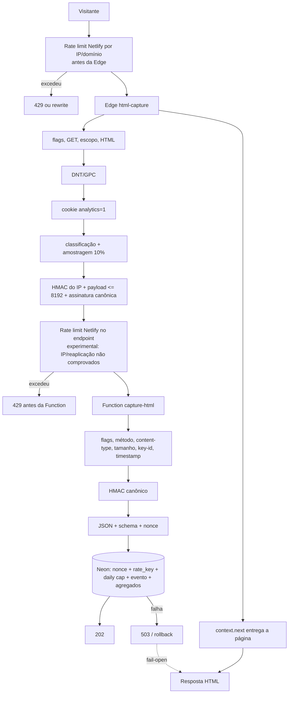

# Fase 5F.1.4 — Validação do rate limiting e orçamento de créditos

Status: **auditoria e planejamento concluídos; nenhuma regra implementada, nenhum deploy e nenhuma ativação**.
Data: 2026-11-11.
Branch: `feat/portal-analytics`.
Commit de referência durante toda a fase: `8d455fc4f01f7944f2a015681dd5c81c0704d786`.

A Fase 5F.2 **não** foi iniciada. Nenhuma validação remota foi executada.

---

## A. Resumo executivo

**Resultado:** a sintaxe e a rota do rate limiting code-based são compatíveis com os arquivos atuais,
e o rate limiting nativo pode reduzir invocações da Function. Porém, **não está documentado qual IP
a Netlify usa para agregar a chamada interna Edge → Function**. Também não está explícito se o
rate limiting é reavaliado nessa nova cadeia de requisição. Essas duas questões impedem afirmar que
uma regra no endpoint `/api/capture-html` protegerá contra abuso externo sem afetar o tráfego
legítimo da Edge.

**Recomendação:** manter a **Alternativa B** da Fase 5F.1.3, com duas camadas:

1. **Rate limiting nativo da Netlify por IP** para reduzir volume antes da Edge/Function;
2. **HMAC + rate limit por `rate_key` + limite diário** já existentes para validar e limitar eventos.

Para o endpoint `/api/capture-html`, a regra nativa só deve ser habilitada depois de um teste
controlado em alvo público que comprove:

- se a chamada interna Edge → Function é contabilizada;
- qual IP entra na agregação;
- se a regra na Function usa o IP do visitante ou o IP de saída da infraestrutura;
- se o rate limit é reaplicado na nova cadeia;
- qual a taxa real de falsos positivos.

**Enquanto isso não for comprovado, não é seguro prometer que o rate limit nativo na Function reduz
abuso externo.** A proteção que não depende dessa hipótese é o rate limit na **Edge page path**, que
usa o IP do visitante documentado pela plataforma, mas que é mais amplo e pode afetar a entrega de
páginas.

**Bloqueios principais:**

- identidade do IP na chamada interna: **NÃO COMPROVADO**;
- reaplicação do rate limiting na nova cadeia: **NÃO COMPROVADO**;
- disponibilidade de `rateLimit` no `config` da Edge: documentada na página de rate limiting, mas
  ausente da lista de propriedades da página de declarations — **requer deploy de teste**;
- limites ideais dependem de dados de tráfego/NAT que não existem;
- saldo atual de créditos precisa ser confirmado pelo usuário.

**Classificação final:** **3 — Aprovado para planejamento de validação remota**. Não é aprovação
para executar a Fase 5F.2 nem para afirmar funcionamento real.

---

## B. Estado inicial do Git

| Item | Valor |
|---|---|
| Diretório | `D:\Projetos\Site Calculadora` |
| Branch | `feat/portal-analytics` |
| Commit | `8d455fc4f01f7944f2a015681dd5c81c0704d786` |
| Divergência do commit informado | Nenhuma |
| `git status --short` inicial | 256 entradas (alterações das fases anteriores preservadas) |
| `git status --short` final | 257 entradas (256 + este relatório) |
| Operações destrutivas | Nenhuma |

Arquivos examinados nesta fase:

- `netlify/edge-functions/html-capture.js`
- `netlify/edge-functions/_lib/edge-capture.mjs`
- `netlify/edge-functions/_lib/capture-policy.mjs`
- `netlify/edge-functions/_lib/capture-limits.mjs`
- `netlify/edge-functions/_lib/capture-signature.mjs`
- `netlify/edge-functions/_lib/edge-env.mjs`
- `netlify/functions/capture-html.mjs`
- `netlify/functions/_lib/capture-handler.mjs`
- `netlify/functions/_lib/capture-config.mjs`
- `netlify/functions/_lib/capture-validation.mjs`
- `netlify/functions/_lib/db.mjs`
- `netlify.toml`
- `_redirects`
- `package.json`
- `docs/analytics/fase-5f-1-2-auditoria-independente.md`
- `docs/analytics/fase-5f-1-3-projeto-protecao-abuso.md`

Não há `rateLimit`, `rate_limit`, `windowLimit` ou `aggregateBy` no código ou no `netlify.toml`.
Não há dependência `@netlify/functions`, `@netlify/edge-functions` ou `@netlify/blobs` instalada.

Teste local não destrutivo: `npm run test:analytics` = **72 aprovados, 0 falhas**; as suítes
`capture.integration` e `collect.integration` foram skipped por ausência de `TEST_DATABASE_URL`.

---

## C. Documentação oficial

Consultada em **2026-11-11**.

| Fonte | Título | Conclusão usada |
|---|---|---|
| https://docs.netlify.com/manage/security/secure-access-to-sites/rate-limiting/ | Rate limiting | Code-based em todos os planos; Free 2 regras/projeto; agregação por domínio e IP; 429 ou rewrite; atraso de até 10 s; agregado global por domínio é Enterprise |
| https://docs.netlify.com/resources/troubleshooting/request-chain/ | Request Chain | Ordem: Firewall → WAF → Rate limiting → Password Protection → Edge Functions → cache → Functions; rate limiting antes das Functions |
| https://docs.netlify.com/build/edge-functions/declarations/ | Edge Functions declarations | `fetch()` interno inicia **nova request chain** e reexecuta Edge functions; lista de propriedades inline não inclui `rateLimit` |
| https://docs.netlify.com/build/functions/api/ | Functions API reference | `config.rateLimit`, `context.ip` e `waitUntil` documentados para Functions |
| https://docs.netlify.com/build/functions/configuration/ | Configuration for functions | Padrão 1024 MB, 60 s; região padrão `cmh`; seleção de região é Pro/Enterprise |
| https://docs.netlify.com/build/edge-functions/api/ | Edge Functions API | `context.ip` é IP do cliente; `waitUntil`; Netlify não adiciona headers específicos por padrão |
| https://docs.netlify.com/build/edge-functions/limits/ | Edge Functions limits | CPU 50 ms por request; `waitUntil` também está sujeito ao CPU |
| https://docs.netlify.com/build/edge-functions/usage-and-billing/ | Edge Functions usage and billing | Invocações são métrica de uso de Edge |
| https://docs.netlify.com/manage/accounts-and-billing/billing/billing-for-credit-based-plans/how-credits-work/ | How credits work | Web requests 2/10k; compute 10/GB-h; Edge entra em web requests, não em compute |
| https://docs.netlify.com/build/functions/usage-and-billing/ | Functions usage and billing | Functions compute em GB-hora |
| https://docs.netlify.com/build/data-and-storage/netlify-blobs/ | Netlify Blobs | Consistência e regiões; usado apenas para a contingência C |
| https://neon.com/docs/introduction/plans | Neon plans | Free: 100 CU-h/projeto, 1 GB, 5 GB egress, scale-to-zero 5 min |
| https://owasp.org/API-Security/editions/2023/en/0xa4-unrestricted-resource-consumption/ | OWASP API4:2023 | Limitar consumo de recursos e interações por cliente |

**Conflito documental registrado:** a página de **Rate limiting** mostra `rateLimit` no `config` de
Edge Function, mas a página **Edge Functions declarations** lista `path`, `excludedPath`, `pattern`,
`excludedPattern`, `method`, `header`, `onError` e `cache`, sem `rateLimit`. A compatibilidade real
da propriedade no Edge deve ser validada no bundler/deploy de teste; não presuma que o exemplo da
página de rate limiting se aplica automaticamente à versão atual do projeto.

---

## D. Configuração técnica

### Situação atual do código

`netlify/functions/capture-html.mjs`:

```js
export const config = {
    path: '/api/capture-html'
};

export default createCaptureHandler({
    getPool: () => getSharedPool(process.env)
});
```

`netlify/edge-functions/html-capture.js` exporta `config` com `path: '/*'`, uma longa lista de
`excludedPath` e `onError: 'bypass'`.

- A Function usa `config.path`, então é servida **somente** em `/api/capture-html`; o caminho
  padrão `/.netlify/functions/capture-html` não é usado quando há `path` customizado.
- Não há redirect/rewrite para `/api/capture-html`; não há conflito com `collect` (`/api/collect`) ou
  com a Scheduled Function.
- A Edge exclui `/api/*`, portanto a Edge não roda no endpoint da Function; isso evita recursão.
- O `rateLimit` é uma propriedade adicional do mesmo objeto `config`. A sintaxe JS é compatível:
  não exige mudar o formato de `export default` nem instalar um SDK.
- Não há `@netlify/functions`/`@netlify/edge-functions` instalado; portanto não há checagem de tipos
  local. A validação do `config` é feita pelo build/deploy da Netlify, não pelo runtime Node.
- A Netlify valida regras code-based no pós-processamento do deploy; uma regra inválida não falha o
  deploy, então é necessário inspecionar o log do deploy de teste.
- Verificação local: `import()` do arquivo da Function retornou `config = { path: '/api/capture-html' }`
  e `default` do tipo `function`; a Edge retornou `config` com `path`, `excludedPath` (29 itens) e
  `onError`, com `default` do tipo `function`. Isso comprova o formato de export atual, mas **não**
  comprova que o bundler aceitará `rateLimit`.

### Exemplo ilustrativo — NÃO APLICADO

Valores provisórios, apenas para demonstrar a forma. Não copiar para produção sem teste.

```js
// Exemplo ilustrativo. NÃO APLICADO.
export const config = {
    path: '/api/capture-html',
    rateLimit: {
        windowLimit: 300,       // provisório
        windowSize: 60,         // segundos; máximo documentado: 180
        aggregateBy: ['ip', 'domain'],
        action: 'rate_limit'    // 429
        // Para rewrite: action: 'rewrite', to: '/caminho-estatico'
    }
};
```

Para a Edge, o exemplo seria o mesmo bloco `rateLimit` dentro do `config` atual, mas **isso não foi
validado** e a regra incidiria sobre o path `/*` e a semântica de `excludedPath` não está documentada
para rate limiting.

### Limites documentados

- **Code-based:** todos os planos; **2 regras por projeto no Free**; regras controladas por branch/
  deploy no código-fonte (a UI não é usada).
- **UI-based:** somente Enterprise com High-Performance Edge.
- **Agregação:** `['ip', 'domain']` no Free; agregação **somente por domínio** (limite global
  compartilhado) é Enterprise.
- **Ações:** `rate_limit` (429) ou `rewrite` para um path estático.
- **Janela:** `windowSize` máximo documentado **180 s**; mínimo não localizado na documentação
  consultada — **NÃO COMPROVADO**. Usar 60 s nos testes.
- **Enforcement:** atraso de até **10 s**; requisições no intervalo podem ainda chegar ao projeto.
- **Contagem de regras publicadas/não publicadas:** a documentação descreve regras code-based via
  branches; para UI há rulesets separados. O detalhe de contagem code-based entre publicado e
  não publicado não está explícito — **NÃO COMPROVADO**.
- **429:** documentado para a ação de bloqueio.
- **Firewall Traffic Rules:** Free tem 2 regras, até 3 IPs e 3 geolocalizações por regra; estático,
  não é rate limit dinâmico.
- **WAF:** Enterprise.
- **DDoS:** proteção de rede padrão em todos os planos.

---

## E. Chamada Edge → Function e identidade do IP

| Questão | Resultado | Fonte | Confiança |
|---|---|---|---|
| Nova requisição HTTP | **Sim.** `fetch()` interno inicia nova request chain; Edge functions do path de destino são reexecutadas. | Edge declarations / Request Chain | Alta |
| Rate limit aplicado à chamada interna | **NÃO COMPROVADO.** A nova cadeia é documentada, mas não há afirmação explícita de que o estágio de rate limiting é reavaliado para o `fetch` interno. | Edge declarations / Rate limiting | Baixa |
| IP original preservado | **NÃO COMPROVADO.** Não há documentação de propagação do IP do visitante. O `fetch` não envia cabeçalho de IP. | Edge API / Functions API | Baixa |
| IP de saída utilizado | **NÃO COMPROVADO.** É plausível que a agregação use o IP da infraestrutura de saída da Netlify, mas isso não está documentado. | Rate limiting / Functions API | Baixa |
| Domínio de agregação | **Provável domínio original**, porque `baseUrl` é `request.url` e o `fetch` usa o mesmo host; a agregação interna não está documentada. | Código `enviarEvento` / Rate limiting | Média |
| Cabeçalhos de origem confiáveis | **Nenhum cabeçalho interno documentado.** A Edge API diz que a Netlify não adiciona headers específicos; `X-Forwarded-For`, `X-Real-IP`, `Forwarded`, `Origin` e `Referer` são controláveis e não devem ser usados como prova. | Edge API | Alta (para “não documentado”) |
| `context.ip` da Edge é o IP do visitante | **Sim**, documentado como “client IP address”. | Edge API | Alta |
| `context.ip` da Function na chamada interna | **Não é o visitante original**, por definição de nova requisição; o “cliente” é quem chamou a Function. O valor exato não é documentado. | Functions API + análise | Média |
| Propagação automática do contexto | **NÃO COMPROVADO.** Não há documentação de que `context.ip` da Edge seja propagado ao `fetch`/Function. | Edge API / Functions API | Baixa |
| Cabeçalho interno que preserve a origem | **Nenhum documentado.** Não criar header próprio confiável; ele seria falsificável por chamada externa. | Edge API | Alta (negativa documental) |

### Conclusão operacional

Não é possível afirmar, somente pela documentação, que uma regra de rate limit em
`/api/capture-html` verá o IP do visitante. Também não é possível afirmar que a regra não afetará a
chamada interna. Portanto:

- **Não usar `X-Forwarded-For`, `X-Real-IP`, `Forwarded`, `Origin`, `Referer` ou UA como
  autenticação ou como identificador confiável.**
- **Não criar um header de IP próprio** sem assinatura; uma chamada externa poderia forjá-lo.
- A proteção que não depende dessa hipótese é a regra no **path de páginas da Edge**, que usa o IP
  do visitante documentado pela plataforma, mas é mais ampla.
- A regra no endpoint da Function deve ser tratada como **experimental** até o teste controlado.
- O HMAC e o rate limit por `rate_key` dentro da Function continuam necessários.

---

## F. Limites propostos

Valores **provisórios**. A escolha final depende de medir distribuição de IPs/NAT, picos e o efeito
da chamada interna.

Premissas: captura amostrada em 10%; page views normais; um visitante carrega poucas páginas por
minuto; NAT pode concentrar muitos visitantes em um IP; Janela de 60 s; máximo documentado de
`windowSize` é 180 s.

| Cenário | Edge page path (por IP) | Function endpoint (por IP) | Impacto esperado | Falsos positivos | Risco residual | Justificativa |
|---|---:|---:|---|---|---|---|
| **Conservador** | 30 req/60 s | 60 req/60 s | Bloqueia cedo, reduz muito a invocação | Alto em NAT, escolas, empresas, redes móveis | Menor custo de abuso, maior perda de tráfego legítimo | Só para teste de estresse; não recomendado para produção |
| **Equilibrado** | 120 req/60 s | 300 req/60 s | Reduz rajadas sem afetar navegação típica | Médio em NAT grande; baixo para usuário individual | Médio; atacante distribuído ainda passa | Ponto de partida para testar em alvo público |
| **Permissivo** | 300 req/60 s | 1.200 req/60 s | Quase não afeta legítimos; reduz só abuso muito intenso | Baixo | Alto para abuso distribuído e invalidação | Se o teste mostrar que a regra da Function vê IP de egress compartilhado |

**Ação recomendada nos testes:** `rate_limit` (429) para o endpoint da Function; para páginas,
avaliar `rewrite` para uma página estática, para não mostrar 429 a visitantes legítimos. O `rewrite`
também não deve ser usado como autenticação.

**Por que não há número definitivo:** faltam dados de:

- quantos page views por IP/minuto em horário de pico;
- tamanho dos NATs e redes compartilhadas;
- distribuição de IPs de saída da Edge para a Function;
- picos reais de tráfego;
- duração real da Function e cold start;
- taxa de requisições inválidas.

**Regra de ouro:** o rate limit de plataforma não substitui o HMAC; ele apenas reduz volume antes da
Function. O limite diário e o rate limit por `rate_key` continuam sendo a proteção de negócio.

---

## G. Orçamento

### Tarifas e fórmulas oficiais

- Web requests: **2 créditos por 10.000** requests (qualquer request ao site, incluindo Edge, API
  Functions, assets e redirects).
- Compute de Function: **10 créditos por GB-hora**; memória padrão **1 GB**.
- Edge Functions: entram em **web requests**, não em compute. A página de uso de Edge também expõe
  uma métrica de invocações; não contar a mesma requisição duas vezes.
- Scheduled Functions: compute de Function; execução máxima **30 s**.
- Deploy de produção: **15 créditos**; Deploy Preview/branch: **0**.
- Free: **300 créditos/mês**, limite rígido; ao esgotar, projetos pausam.
- Saldo de **141,9** é histórico informado; **não consultado** nesta fase.
- Neon é externo ao billing Netlify; está sujeito ao Neon Free (100 CU-h/projeto/mês, 1 GB de
  storage, 5 GB de egress, scale-to-zero após 5 min).

Variáveis:

```
R = requisições HTML/dia que passam pela Edge
c = fração com consentimento/escopo válido (use 1,0 para limite superior)
s = 0,10 (amostragem)
V = R × c × s = capturas válidas/dia
A = POSTs inválidos/dia que chegam à Function
F = V + A = invocações da Function/dia
d = duração média da Function em segundos (hipótese, não medida)
```

Fórmulas mensais (30 dias):

```
web requests Edge (páginas) = 2 × 30R / 10.000 = 0,006R
web requests Function       = 2 × 30F / 10.000 = 0,006F
compute Function            = 10 × (30F × d / 3600) = 0,083333 × F × d
total captura/Function      = 0,006F + 0,083333Fd
total site aproximado       = 0,006R + 0,006F + 0,083333Fd
escritas Neon/mês           ≈ 30 × V × 6
```

`d = 0,05 s` (50 ms) é **cenário hipotético** para as tabelas; não é uma medição. Cold start pode
aumentar. Com `d = 0,01 s`, o compute cai 5x; web requests não caem.

### Cenário normal, sem invalidação extra (`A = 0`, `c = 1`, `s = 0,1`, `d = 50 ms`)

| HTML req./dia | Invocações Edge/dia | Edge → Function/dia (V) | Invocações Function/dia (F) | Válidas/dia | Inválidas/dia | Escritas Neon/mês | Web Edge/mês | Web + compute Function/mês | Total site aprox. |
|---:|---:|---:|---:|---:|---:|---:|---:|---:|---:|
| 1.000 | 1.000 | 100 | 100 | 100 | 0 | 18.000 | 6,00 | 1,02 | 7,02 |
| 10.000 | 10.000 | 1.000 | 1.000 | 1.000 | 0 | 180.000 | 60,00 | 10,17 | 70,17 |
| 100.000 | 100.000 | 10.000 | 10.000 | 10.000 | 0 | 1.800.000 | 600,00 | 101,67 | 701,67 |
| 1.000.000 | 1.000.000 | 100.000 | 100.000 | 100.000 | 0 | 18.000.000 | 6.000,00 | 1.016,67 | 7.016,67 |

**Leitura:** 10 mil páginas/dia consomem cerca de **70 créditos/mês**; 100 mil já estouram os 300
somente pela operação normal. A 1M/dia é incompatível com o Free.

### Cenário de abuso

#### POSTs inválidos que chegam à Function e falham no HMAC/schema (`d = 50 ms`)

| POSTs inválidos/dia | Invocações Function/dia | Web requests Function/mês | Compute/mês | Total/mês |
|---:|---:|---:|---:|---:|
| 1.000 | 1.000 | 6,00 | 4,17 | 10,17 |
| 10.000 | 10.000 | 60,00 | 41,67 | 101,67 |
| 100.000 | 100.000 | 600,00 | 416,67 | 1.016,67 |
| 1.000.000 | 1.000.000 | 6.000,00 | 4.166,67 | 10.166,67 |

- **Bloqueado antes da Function:** o custo de Function/compute é **0**; a requisição ainda pode ser
  contada como web request pela plataforma. A documentação não explicita a cobrança de um 429 de
  rate limit — **NÃO COMPROVADO**. Conservadoramente, some `0,006 × A` créditos/mês se cada 429
  contar como web request.
- **Falha no HMAC:** o custo é web request + compute, sem Neon. O HMAC só é calculado após leitura do
  corpo.
- **Passa no HMAC e falha no schema:** custo semelhante ao anterior + parse/Zod, sem Neon.
- **Passa em tudo e grava:** web request + compute + transação Neon; o limite diário pode rejeitar
  antes da gravação, mas a Function já foi invocada e a transação já foi aberta.
- **Atraso de enforcement de até 10 s:** parte da rajada ainda chega à Function, mesmo com regra
  ativa. O custo não é zero no início do ataque.

### Limpeza e Neon

- Cleanup: 30 execuções/mês; limite de 30 s; com 1 GB, 30 × 30 s = 900 s = 0,25 GB-h = 2,5 créditos
  no pior caso teórico; na prática, execuções curtas devem ficar **bem abaixo de 0,1 crédito/mês**.
  Medir.
- Neon: sem créditos Netlify; cada evento válido faz cerca de 6 operações e grava evento + agregados.
  O volume de consultas/escritas é proporcional a `V`; invalidações que falham antes do banco não
  consultam o Neon.
- O limite diário de 25.000 eventos é **alto para o Free**: 25.000 capturas/dia já custam ~254
  créditos/mês só de captura, antes de páginas. Para teste, usar limite diário muito menor.

### Limitações dos cálculos

- Duração e cold start reais não medidos.
- Distribuição de consentimento, IPs, NAT e picos desconhecida.
- Bandwidth e assets não incluídos; o tráfego de página já existe independentemente da captura.
- A cobrança de 429 de rate limit como web request não está documentada.
- O custo de Blobs (Alternativa C) não é publicável com precisão; a Netlify não publica tarifa
  separada por GB/operação para Blobs.

---

## H. Arquitetura final proposta



**Antes da Function:** DDoS/rate limit de plataforma, validações de flags/escopo/consentimento,
classificação, amostragem, HMAC do IP, limite de payload, assinatura.
**Depois da invocação:** validação de método/content-type/tamanho/key-id/timestamp, HMAC,
JSON/schema/nonce e transação Neon.
**Fail-open:** qualquer falha de captura/Function/Neon não altera a resposta HTML.

| Camada | Responsabilidade | Proteção | Dados | Não coletar |
|---|---|---|---|---|
| Netlify DDoS/rate limit | Cortar volume e rajadas | DDoS; rate limit por IP/domínio | IP na plataforma | IP bruto no app; header de cliente como identidade |
| Edge | Decidir e emitir evento | Flags, escopo, GET/HTML, DNT/GPC, cookie, amostra, HMAC IP, tamanho, assinatura | Caminho, headers normalizados, IP só para HMAC, cookie de consentimento | Corpo da resposta, cookies de auth, UA bruto, query, dados de calculadora |
| Function | Autenticar e validar | Método, content-type, tamanho, key-id, timestamp, HMAC, Zod, nonce | Payload validado | IP bruto, UA bruto, cookies, valores |
| Neon | Persistir e limitar | Nonce, rate HMAC IP, daily cap, retenção | Evento/agregados aprovados | Dados de visitante da Fase 4 |
| Scheduled cleanup | Expirar | Retenção 7/90/13 meses, 24 h | Datas/contadores | Dados pessoais |

---

## I. Critérios de aprovação para a Fase 5F.2

- [ ] Configuração code-based documentada, incluindo sintaxe final e limites provisórios.
- [ ] Rota `/api/capture-html` identificada corretamente e sem conflito com Edge/redirects.
- [ ] Comportamento do rate limit na chamada interna Edge → Function compreendido.
- [ ] Identidade do IP na chamada interna comprovada, ou estratégia que não dependa dela.
- [ ] Limites iniciais justificados com dados de tráfego/NAT.
- [ ] Orçamento de créditos calculado com fórmulas e premissas explícitas.
- [ ] Saldo atual de créditos confirmado pelo usuário.
- [ ] Arquitetura de homologação definida (alvo público dedicado ou C).
- [ ] HMAC validado em runtime real.
- [ ] Replay validado com PostgreSQL real e concorrência.
- [ ] Limites de payload validados no runtime.
- [ ] Fail-open validado: falha de captura não bloqueia a página.
- [ ] Consentimento validado no frontend e no Edge.
- [ ] Allowlist de variáveis e imports/bundler validados.
- [ ] Usuário autorizou expressamente a Fase 5F.2 e o orçamento.

Enquanto a identidade do IP e a reaplicação do rate limit não estiverem comprovadas, **não** ativar
regra no endpoint da Function em produção. A regra na Edge page path pode ser testada em alvo público,
mas também precisa de medição de falsos positivos.

---

## J. Conclusão

**Classificação: 3 — Aprovado para planejamento de validação remota.**

A configuração é sintaticamente compatível e a arquitetura B continua recomendada, mas a pergunta
central desta fase — qual IP a Netlify usa na chamada interna Edge → Function e se o rate limiting é
reaplicado — **não tem resposta documental**. Portanto, não é possível afirmar que uma regra no
endpoint da Function protegerá contra abuso externo sem prejudicar chamadas internas. O teste
controlado em alvo público é obrigatório antes de qualquer ativação.

Não é **4 — aprovado para solicitação de autorização da Fase 5F.2**, porque faltam evidências de
runtime, IP, orçamento medido e saldo atual. Não é **1 — reprovado**, porque não há defeito local
comprovado; a arquitetura e a sintaxe são viáveis e o caminho de validação está definido.

**A Fase 5F.1.4 termina com este relatório.** Não iniciar a Fase 5F.2. Aguardar avaliação e
autorização explícita do usuário.

---

## Confirmação de estado

- Produção intacta.
- Homologação intacta.
- Visibilidades inalteradas.
- Todas as flags continuam `false`.
- Nenhum deploy, build remoto, Deploy Preview ou branch deploy.
- Nenhuma variável, secret, DNS ou configuração remota alterada.
- Nenhum POST remoto e nenhuma execução remota.
- Nenhuma escrita, exclusão, migration ou role no Neon.
- Nenhum commit, push, PR ou merge.
- Nenhuma credencial exibida.
- Nenhum serviço pago contratado ou ativado.
- Nenhuma regra de rate limiting implementada.
