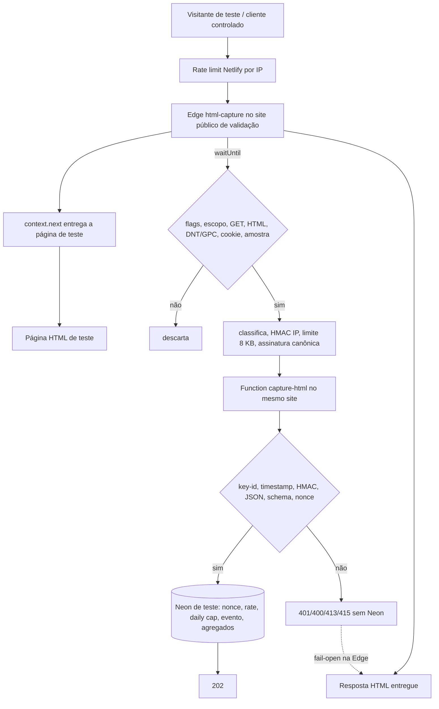
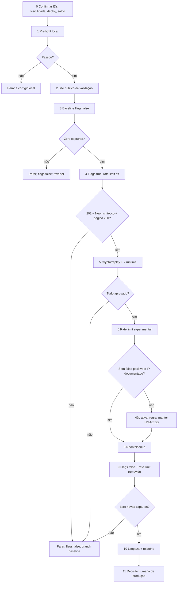

# Fase 5F.2 — Plano de validação remota controlada

Status: **planejamento concluído; aguardando revisão e autorização humana**.
Data: 2026-11-11.
Branch: `feat/portal-analytics`.
Commit de referência: `8d455fc4f01f7944f2a015681dd5c81c0704d786`.

A Fase 5F.3 **não** foi iniciada. Nenhum deploy, POST remoto, execução remota, alteração de
configuração, escrita no Neon, commit ou push foi realizado.

---

## 1. Resumo executivo

O código local está consistente, mas a arquitetura B **não pode ser validada na homologação
privada**: a proteção de projeto privado é site-wide e não há bypass de SSO documentado. Para
preservar a homologação privada e não tocar a produção, o plano recomenda:

**B1 — criar ou identificar um site público de validação dedicado, com o mesmo build e o mesmo
código, apontando para um banco Neon de teste.** A homologação privada continua usada apenas para
testes de página, consentimento, flags e falha silenciosa. A produção permanece pública, intocada,
com todas as flags `false`.

Se o usuário não autorizar nenhum alvo público, a contingência é **C — Netlify Blobs + Scheduled
Function**, que exige implementação nova e tem custo de Blobs não estimável com precisão. **B na
mesma homologação privada não é viável.**

**Principais conclusões:**

- A rota `/api/capture-html` está correta e não conflita com Edge/redirects.
- `config.rateLimit` é sintaticamente compatível, mas a disponibilidade no Edge não está na lista
  de propriedades da página de declarations; exige deploy de teste.
- A chamada interna Edge → Function inicia nova request chain; **não está documentado** se o rate
  limiting é reaplicado nela, nem qual IP é usado na agregação.
- O IP do visitante não deve ser presumido na Function; não usar `X-Forwarded-For`, `Origin`,
  `Referer` ou UA como identidade.
- O rate limit nativo no Free é por IP/domínio, com 2 regras por projeto e atraso de até 10 s; não
  há limite global.
- O HMAC continua sendo a autenticação de serviço; ele não identifica pessoas nem prova
  consentimento.
- O timeout de 2000 ms, a CPU real do Edge, o bundler e a latência Ohio → São Paulo continuam
  **não comprovados**.

**Orçamento proposto:** teto de **32 créditos** para a campanha, reserva mínima de **100 créditos**
para produção/operação, início somente com saldo confirmado ≥ **132 créditos**. O custo dominante
são deploys (15 cada), não a captura em volume pequeno. O saldo histórico de 141,9 **não** foi
consultado e deve ser reconfirmado.

**Recomendação:** aprovar B1 e autorizar a Fase 5F.3 somente após confirmar site público, IDs,
visibilidade, deploy atual, banco de teste, saldo e limites. Este documento **não** autoriza
execução.

---

## 2. Estado atual comprovado

| Item | Valor |
|---|---|
| Diretório | `D:\Projetos\Site Calculadora` |
| Branch | `feat/portal-analytics` |
| Commit | `8d455fc4f01f7944f2a015681dd5c81c0704d786` |
| `git status --short` inicial | 257 entradas (fases anteriores preservadas) |
| `git status --short` final | 258 entradas (257 + este relatório) |
| Alterações funcionais nesta fase | Nenhuma |
| Relatório novo | Este arquivo |

### Código e configuração

- Edge: `netlify/edge-functions/html-capture.js`, `path: '/*'`, `excludedPath` com 29 itens,
  `onError: 'bypass'`.
- Function: `netlify/functions/capture-html.mjs`, `config.path = '/api/capture-html'`.
- Não há `rateLimit` no código ou no `netlify.toml`.
- Não há `@netlify/functions`, `@netlify/edge-functions` ou `@netlify/blobs` instalado.
- Node do build: `22`; `.mjs` na Function e `.js` na Edge; ambos ESM.
- A Edge exclui `/api/*`; portanto não roda no endpoint da Function e não há recursão.
- Não há redirect/rewrite para `/api/capture-html`; não há conflito com `collect` ou cleanup.

### Testes locais executados

`npm run test:analytics`: **72 aprovados, 0 falhas**. As suítes `capture.integration` e
`collect.integration` foram skipped por ausência de `TEST_DATABASE_URL`. O benchmark local p95 de
processamento puro foi ~0,79 ms; isso **não** representa o Edge/Function reais.

### Identificadores históricos (confirmar antes de qualquer ação)

| Alvo | ID | Visibilidade histórica | Deploy histórico | Uso no plano |
|---|---|---|---|---|
| Homologação | `3da70f72-70f7-4883-b60b-25b430cc9270` | Privada | `6af47527818a48a5dbbef2c4` | Apenas página/consentimento/flags; **não** para B |
| Produção | `273101e3-7a01-4931-aeaf-4cee4fe74f07` | Pública | `6af0feebef830ebab5cd25dd` | **Não tocar** |
| Neon homologação | `square-mountain-69641645` | — | — | Banco de teste; confirmar branch/DB |
| Site público de validação | **a definir** | Deve ser público | — | B1; ID obrigatório antes da 5F.3 |

Os IDs/deploys são **históricos** do contexto do projeto. Antes de qualquer deploy futuro, confirmar
simultaneamente Site ID, nome do site, domínio, visibilidade e deploy atual. Não usar apenas o nome.

---

## 3. Arquitetura recomendada

### B1 — Site público de validação dedicado (recomendado)

Fluxo:



**Por que B1:**

- preserva a homologação privada como está;
- preserva a produção como está;
- testa o mesmo fluxo same-origin da produção (Edge → Function no mesmo site);
- permite medir rate limit, IP, bundling, HMAC, timeout e Neon;
- pode ser desligado removendo o deploy/branch ou definindo flags `false`;
- não exige repassar cookie de SSO nem tornar a homologação pública.

**Custo:** um site público de validação é uma nova superfície pública. Ele deve conter apenas
conteúdo sintético/teste, com `noindex`, sem links do portal, sem dados reais e sem tráfego de
visitantes. A criação do site e qualquer deploy exigem autorização da Fase 5F.3.

### B2 — Edge na homologação privada + endpoint de ingestão público separado

Também preserva as páginas privadas, mas a Edge faria `fetch` **cross-site** para um site público
de ingestão. Testa HMAC/rate limit, mas não replica o fluxo same-origin da produção e adiciona um
segundo site/domínio/segredo. É uma opção se for inaceitável publicar um site de validação com
páginas.

### C — Netlify Blobs + Scheduled Function

A Edge grava o evento em Blob; uma Scheduled Function lê, valida e grava no Neon. Mantém a
homologação privada e não expõe endpoint público. Exige implementação nova, idempotência,
consistência, limpeza e aceitação de atraso. É contingência, não recomendação primária.

### Decisão

**Recomendação: B1.** Se o usuário proibir qualquer site público novo, escolher C e tratar a
implementação como uma fase separada. **Não escolher B na homologação privada**, porque isso não
funciona.

---

## 4. Comparação B e C

| Dimensão | B1 — público dedicado | B2 — ingestão pública separada | C — Blobs + Scheduled |
|---|---|---|---|
| Segurança | Média/alta: HMAC, limites; endpoint público | Média/alta; dois sites e segredo compartilhado | Alta no ingresso; sem endpoint público |
| Privacidade | Boa; site de teste sem dados reais | Boa; páginas privadas | Boa; Blob privado, mas retenção temporária |
| Complexidade | Baixa/média | Média | Alta |
| Custo | Deploy + web requests/compute; baixo no teste | Dois sites; mais egress/configuração | Blobs + scheduled compute; conversão em créditos não publicada |
| Plano Free | Compatível | Compatível, mas mais peças | Compatível em tese; custo de Blobs incerto |
| Manutenção | Baixa | Média | Alta |
| Risco de abuso | Endpoint público; rate limit/HMAC | Endpoint público; cross-site | Sem ingresso HTTP; escrita em Blob ainda pode ser abusada |
| Parar coleta | Flags false ou remover deploy/branch | Flags false + remover endpoint | Flags false + parar scheduled + limpar Blobs |
| Fidelidade à produção | Alta (same-origin) | Média (cross-site) | Baixa (assíncrona) |
| Recomendação | **Primária** | Alternativa se público de páginas for inaceitável | Contingência se nenhum público for aceito |

---

## 5. Matriz de testes

Legenda de ambiente: **L** local, **B** bundler/build local, **P** site público de validação,
**D** banco de teste, **R** runtime real. Nenhum teste remoto é executado nesta fase.

### 5.1 Conectividade Edge → Function e rate limiting

| ID | Objetivo | Ambiente | Procedimento | Aprovação | Interrupção |
|---|---|---|---|---|---|
| T01 | Provar que projeto privado não permite Edge → Function | P/privado controlado | Acessar página com sessão de equipe e observar tentativa; não usar bypass | Falha documentada como esperada; nenhuma gravação | Qualquer bypass ou coleta inesperada |
| T02 | Edge alcança Function no site público | P/R | Página de teste com consentimento; flags true; amostra 1 | Function 202 e linha sintética no Neon de teste | 401/403/200 de login ou nenhuma linha |
| T03 | 401/403 tratados como falha | P/R | Forçar key-id/HMAC inválido no teste; observar Edge/Function | Edge não considera sucesso; nenhuma linha | Edge considerar 401/403 como sucesso |
| T04 | Página de login 200 não confundida com sucesso | P/R | Endpoint de teste retorna 200 HTML de login; verificar `status === 202` | Nenhum evento; sem 202 | Evento gravado ou 200 aceito |
| T05 | Rate limit desativado | P/R | Branch sem `rateLimit`; 200 páginas controladas | Sem 429; eventos válidos conforme amostra | 429 inesperado |
| T06 | Rate limit ativo na Edge page path | P/R | Branch com regra; rajada controlada | 429/rewrite no limite; página normal abaixo | Bloqueio de página legítima; assets afetados |
| T07 | Rate limit ativo na Function endpoint | P/R | Regra no endpoint; POSTs controlados | 429 no limite; sem Function além do limite | Chamada interna bloqueada ou IP inesperado |
| T08 | Identidade do IP na chamada interna | P/R | Hash de `context.ip` na Edge e na Function com salt de teste; comparar igualdade sem expor IP | Relatório “igual/diferente”; nenhum IP bruto | Exposição de IP ou conclusão sem evidência |
| T09 | Visitantes diferentes distinguidos | P/R | Clientes controlados com IPs distintos (se autorizado) | Limites separados quando o IP é do visitante | Agregação global inesperada |
| T10 | Limite por IP não bloqueia legítimos | P/R | Simular 10–20 visitantes; NAT controlado | Nenhum 429 indevido no cenário equilibrado | Bloqueio de usuário legítimo |
| T11 | Chamada interna sofre o mesmo limite | P/R | Rule baixa no endpoint; páginas controladas; contar Function | Comportamento documentado (limitado ou não) | Chamada interna bloqueada sem explicação |
| T12 | Regra desativada restaura comportamento | P/R | Voltar ao branch baseline | Sem 429; captura normal | Regra residual |

### 5.2 Criptografia, HMAC e replay

| ID | Objetivo | Ambiente | Procedimento | Aprovação | Interrupção |
|---|---|---|---|---|---|
| T13 | HMAC Web Crypto ↔ Node | P/R | Edge gera evento; Function verifica | 202; sem erro de assinatura | 401 em evento legítimo |
| T14 | Canonicalização | L/P | Vectors locais com key-id/timestamp/nonce/corpo | Assinatura idêntica em Node/WebCrypto | Divergência |
| T15 | Corpo alterado | P/R | Reassinar corpo original, enviar corpo diferente | 401; sem linha | Aceite |
| T16 | Timestamp expirado/futuro | P/R | Requisição assinada com timestamp fora da janela | 401; sem linha | Aceite |
| T17 | Nonce repetido | P/R/D | Enviar a mesma requisição duas vezes | 1º 202; 2º 409; uma linha | Duas linhas ou 202 no replay |
| T18 | Key-id inválido | P/R | Assinar/alterar key-id | 401; sem linha | Aceite |
| T19 | Assinatura inválida | P/R | Corpo válido, assinatura incorreta | 401; sem linha | Aceite |
| T20 | Segredo ausente/inválido | P/R | Branch de teste sem segredo; chamada direta | 503; sem linha; sem vazamento | Aceite ou segredo exposto |
| T21 | Limite de corpo | P/R/D | 0, 1, 8191, 8192 e 8193 bytes; UTF-8 | 8193 → 413; 8192 não → 413; sem gravação indevida | 8193 aceito ou 8192 rejeitado por tamanho |
| T22 | Erros sem segredo | P/R | Inspecionar respostas 401/400/413/503 | Nenhum segredo, connection string ou stack | Vazamento |

### 5.3 Runtime, latência, falha e consentimento

| ID | Objetivo | Ambiente | Procedimento | Aprovação | Interrupção |
|---|---|---|---|---|---|
| T23 | Imports/bundling | B/P | Build no Netlify; inspecionar Function e Edge | Módulos compartilhados presentes | Import ausente/erro de deploy |
| T24 | `context.next` imediato | P/R | Medir TTFB e ordem; captura depois | Página não atrasa pela captura | Captura antes da resposta |
| T25 | `waitUntil` | P/R | Verificar envio após resposta; sem bloquear | Página entregue mesmo com coletor lento | Erro de página |
| T26 | `AbortSignal.timeout` | P/R | Function de teste lenta; timeout 2000 ms | Falha silenciosa; página 200 | Erro não tratado/bloqueio |
| T27 | `onError: "bypass"` | P/R | Branch de teste com erro induzido | Página servida | Página de erro |
| T28 | CPU do Edge | P/R | Amostras com flags/amostra; logs/observabilidade | Sem erros; dentro do orçamento | Erro/timeout por CPU |
| T29 | Cold start Function | P/R | Esperar inatividade; primeira chamada | Medir e registrar p50/p95 | Timeout sistemático |
| T30 | Latência Ohio → São Paulo | P/R | Medir Function/Neon; p50/p95/p99 | Dentro do timeout acordado | p95 acima do limite |
| T31 | Falha do Neon | P/R | Banco de teste indisponível; página | Página 200; captura falha silenciosa | Página afetada |
| T32 | Cookie de consentimento | P/R | Sem cookie, analytics=0, analytics=1, adulterado | Só analytics=1 captura; adulterado não | Coleta sem consentimento |
| T33 | DNT/GPC | P/R | Headers DNT/Sec-GPC | Nenhuma captura | Captura com DNT/GPC |
| T34 | Allowlist de variáveis | P/R | Inspecionar ambiente da Edge | Só allowlist; sem segredos de banco | Segredo de banco no Edge |
| T35 | Retenção/cleanup | D | Dados sintéticos antigos/recentes | Remove vencidos; preserva recentes | Dados fora da retenção ou perda indevida |

### 5.4 Evidências mínimas

- logs de deploy com IDs de regra e sem segredos;
- contagem de linhas antes/depois no Neon de teste;
- códigos de status e tempos, sem IP/UA/cookie/payload;
- hash de IP apenas para o teste T08, sem valor bruto;
- lista de request IDs/nonces sintéticos;
- relatório de custos por etapa.

---

## 6. Plano de rate limiting

### Regras e alvos

| Regra | Alvo | Objetivo | Observação |
|---|---|---|---|
| A | Edge page path (`/*` no site público) | Reduzir páginas/rajadas antes da Edge | Usa IP do visitante; `excludedPath` e rate limit não estão documentados juntos |
| B | Function endpoint `/api/capture-html` | Reduzir POSTs diretos antes da Function | IP/reaplicação na chamada interna **NÃO COMPROVADO**; experimental |

### Cenários provisórios

| Cenário | Regra A (Edge) | Regra B (Function) | Janela | Uso |
|---|---:|---:|---:|---|
| Conservador | 30 req/IP | 60 req/IP | 60 s | Teste de estresse; alto risco de NAT |
| Equilibrado | 120 req/IP | 300 req/IP | 60 s | Ponto de partida recomendado para o teste |
| Permissivo | 300 req/IP | 1.200 req/IP | 60 s | Se o IP interno for compartilhado; menor proteção |

- **Free:** 2 regras code-based por projeto; usar exatamente A e B no teste, ou uma por branch.
  Regras code-based são controladas pelo branch/deploy; a UI de rate limiting é Enterprise com
  High-Performance Edge. O detalhe de contagem code-based entre deploy publicado e não publicado
  não está explícito na documentação — **NÃO COMPROVADO**; validar no deploy de teste.
- **Janela:** 60 s; máximo documentado 180 s; mínimo não localizado.
- **Ação:** `rate_limit` (429) na Function; na Edge, testar 429 e `rewrite` para página estática.
- **Enforcement:** atraso de até 10 s; uma rajada inicial pode passar.
- **Não há limite global por domínio no Free.**
- **Não ativar em produção** nesta fase nem na 5F.3 sem autorização específica.
- **Interrupção/remoção:** voltar ao branch baseline sem `rateLimit`; se necessário, publicar um
  deploy de reversão. Não existe “desligar regra” pela UI no Free.

### Critério para ativar a regra B

Somente após T07, T08, T11 e T09 comprovarem que:

- a regra vê o IP correto ou que o limite não afeta a chamada interna;
- chamadas legítimas não são bloqueadas;
- o comportamento é compreensível e reversível.

Se não for comprovado, **não ativar B**. A proteção fica em A + HMAC + rate limit DB.

---

## 7. Plano criptográfico

### Testes e evidências

1. **WebCrypto → Node:** Edge gera assinatura; Function valida. Evidência: 202, evento no banco.
2. **Canonicalização:** mensagem `edge-v1\n<key-id>\n<timestamp>\n<nonce>\n<corpo>`; testar
   alteração de cada campo separadamente.
3. **Comparação segura:** revisão de código (`timingSafeEqual`); não é mensurável de forma confiável
   por teste remoto.
4. **Replay:** nonce único, PK no banco e transação; testar concorrência no PostgreSQL de teste.
5. **Timestamp:** janela de 60 s; testar passado, futuro e malformado.
6. **Body:** 0/1/8191/8192/8193 bytes; UTF-8; `Content-Length` ausente/mentiroso.
7. **Segredo:** mínimo 32 bytes UTF-8; ausente/inválido → 503; nunca em resposta/log.
8. **Erros:** respostas genéricas; sem stack, connection string, segredo ou payload.

**Não usar segredo real em relatório.** Os scripts devem ler `TEST_EDGE_INGEST_SECRET` do ambiente
de teste; o valor nunca é impresso. O script deve gerar nonces/request IDs e registrar apenas os
identificadores sintéticos.

---

## 8. Plano de runtime e latência

### Metodologia

- **Aquecimento:** 20 requisições descartadas.
- **Amostra:** 100–300 requisições por cenário; p50, p95, p99 quando houver volume; taxa de falhas.
- **Cenários:** Edge page sem captura; captura válida; timeout; Function fria; Neon frio; falha de
  DB; rate limit off/on.
- **Medições:** TTFB da página, tempo total da Edge, duração da Function, tempo de conexão/consulta
  Neon, status HTTP, motivo de falha. Sem IP/UA/cookie/payload nos logs.
- **Cold start:** aguardar a política de scale-to-zero do Neon (5 min) e a inatividade da Function;
  registrar primeira chamada separadamente.
- **Comparação:** resultados locais (Node) e remotos (Netlify) em tabelas separadas. Não apresentar
  benchmark local como prova do Edge.

### Pontos de atenção

- CPU do Edge: 50 ms por request, incluindo `waitUntil`; medir erros e latência, não apenas CPU.
- Timeout atual: **2000 ms é hipótese**; se p95 se aproximar ou houver timeouts, interromper e
  planejar ajuste local (não alterar durante o teste sem autorização).
- Function em `cmh` (Ohio) e Neon em `aws-sa-east-1` (São Paulo): latência cross-region + cold start.
- Região de Function é Pro/Enterprise; no Free não é possível mover para `gru`.
- `AbortSignal.timeout`, `waitUntil`, WebCrypto e `onError` só são comprovados no runtime real.
- Simular falha de DB/Function em branch de teste, não em produção; a página deve continuar 200.

---

## 9. Memória de cálculo dos custos

### Tarifas e regras

- Free: **300 créditos/mês**, limite rígido, sem recarga; ao esgotar, projetos pausam.
- Deploy de produção: **15 créditos**; Deploy Preview/branch: **0**.
- Web requests: **2 créditos/10.000**; Functions API, Edge e assets contam.
- Compute de Function: **10 créditos/GB-hora**; padrão 1 GB; execução síncrona 60 s.
- Edge: entra em web requests; a página de uso também expõe invocações, mas não contar duas vezes.
- Scheduled Function: compute de Function; limite 30 s.
- Neon: sem crédito Netlify; Free 100 CU-h/projeto/mês, 1 GB, 5 GB egress, scale-to-zero 5 min.
- Saldo de 141,9 é **histórico** e não foi consultado.

### Fórmulas

```
R = páginas HTML/dia
c = fração elegível/consentida (1,0 no limite superior)
s = 0,10
V = R × c × s
A = POSTs inválidos/dia que chegam à Function
F = V + A
d = duração média da Function (s)
```

```
créditos web Edge/mês      = 0,006 × R
créditos web Function/mês  = 0,006 × F
créditos compute/mês       = 0,083333 × F × d
total captura/mês          = 0,006F + 0,083333Fd
escritas Neon/mês          ≈ 30 × V × 6
```

`d = 0,05 s` é hipótese; `d = 0,01 s` reduz compute 5x. Não é medição.

### Páginas (A = 0, c = 1, s = 0,1, d = 50 ms)

| Páginas/dia | Edge/dia | Edge→Function/dia | Function/dia | Neon escritas/mês | Web Edge/mês | Function web+compute/mês | Total site aprox. |
|---:|---:|---:|---:|---:|---:|---:|---:|
| 1.000 | 1.000 | 100 | 100 | 18.000 | 6,00 | 1,02 | 7,02 |
| 10.000 | 10.000 | 1.000 | 1.000 | 180.000 | 60,00 | 10,17 | 70,17 |
| 100.000 | 100.000 | 10.000 | 10.000 | 1.800.000 | 600,00 | 101,67 | 701,67 |
| 1.000.000 | 1.000.000 | 100.000 | 100.000 | 18.000.000 | 6.000,00 | 1.016,67 | 7.016,67 |

**Leitura:** 10 mil páginas/dia ≈ 70 créditos/mês; 100 mil/dia ≈ 702 (acima do Free). 1M/dia é
inviável.

### POSTs inválidos

| POSTs inválidos/dia | Chegam à Function: web/mês | Compute/mês | Total/mês | Bloqueados antes da Function |
|---:|---:|---:|---:|---|
| 1.000 | 6,00 | 4,17 | 10,17 | 0 Function; web do 429 incerto (≈6,00 se contado) |
| 10.000 | 60,00 | 41,67 | 101,67 | 0 Function; web do 429 incerto (≈60,00) |
| 100.000 | 600,00 | 416,67 | 1.016,67 | 0 Function; web do 429 incerto (≈600,00) |

- **Falha no HMAC:** web + compute; sem Neon.
- **Passa no HMAC e falha no schema:** web + compute + parse; sem Neon.
- **Passa em tudo e grava:** web + compute + transação Neon; daily cap pode rejeitar antes da
  gravação, mas a Function já foi invocada.
- **429 de rate limit:** a documentação não explicita se conta como web request; tratar como
  **NÃO COMPROVADO** e orçar conservadoramente.
- **Atraso de 10 s:** uma rajada pode chegar antes do bloqueio; o custo não é zero no início.

### Campanha de teste recomendada

| Item | Limite |
|---|---|
| Páginas de teste | 100–300 |
| Capturas válidas | 50–100 |
| POSTs inválidos | ≤ 10.000, preferencialmente 1.000–5.000 |
| Deploys | 2–3 no máximo |
| Custo de deploy | 0 se branch/Deploy Preview público; 15 cada produção |
| Custo de uso | ≤ 5 créditos |
| Teto total da campanha | **32 créditos** |
| Reserva mínima | **100 créditos** |
| Saldo mínimo para iniciar | **132 créditos confirmados** |
| Interrupção | consumo projetado > 32 ou saldo restante < 100 |
| Adiamento | saldo < 132, produção consumindo rápido, ciclo perto do fim |

**Deploys mínimos:**

- Se o site público já existir e os previews forem públicos: **3 branch deploys** (baseline sem
  captura, captura sem rate limit, captura com rate limit) = **0 créditos de deploy**. A reversão é
  voltar ao branch baseline; não é necessário um quarto deploy.
- Se for necessário criar o site público: **1 deploy de produção** para inicializar (15) + até 3
  branch deploys (0) = **15 créditos**.
- Se branch deploy não for público e forem usados deploys de produção: **2 no máximo** (ativar e
  desativar) = **30 créditos**; um terceiro deploy estouraria o teto com uso.

**Não** usar deploy de produção do portal nem da homologação privada.

---

## 10. Roteiro de execução futura (Fase 5F.3)

Nenhum passo abaixo está autorizado ou executado. Antes do passo 1, exigir confirmação simultânea
de Site ID, nome, domínio, visibilidade, deploy atual, projeto Neon, branch/DB e saldo.

| Passo | Objetivo | Alvo/ID | Flags / recursos | Dados | Aprovação | Interrupção | Reversão | Custo |
|---|---|---|---|---|---|---|---|---|
| 0 | Confirmação humana | Homologação `3da70f72-70f7-4883-b60b-25b430cc9270`; produção `273101e3-7a01-4931-aeaf-4cee4fe74f07`; Neon `square-mountain-69641645`; site público a definir | Nenhuma | Nenhum | IDs/nome/domínio/visibilidade/deploy/saldo conferidos | Divergência | Não iniciar | 0 |
| 1 | Preflight local | Repositório | Flags false | Nenhum | 72 testes, build, imports, sem secrets | Falha local | Corrigir localmente | 0 |
| 2 | Preparar site público de validação | Site público (ID a registrar) | Sem flags de captura | Conteúdo sintético | Site público, noindex, sem dados reais | Exposição de dados/links | Remover site/branch | 15 se produção inicial; 0 branch |
| 3 | Baseline sem captura | Site público | `EDGE_CAPTURE_ENABLED=false`, `EDGE_ANALYTICS_ENABLED=false`, sem rateLimit | Página de teste | Página 200; zero Function/Neon | Qualquer captura | Voltar branch anterior | 0 branch |
| 4 | Captura sem rate limit | Site público | Flags true; amostra 1; sem rateLimit; Neon teste | Cookie consent, 50–100 eventos | 202, HMAC, Neon sintético, página 200 | 401/erro/timeout | Flags false/branch baseline | 0 branch; uso |
| 5 | Criptografia/replay | Site público + Neon teste | Igual passo 4 | Requests assinados, nonces, tamanhos | T13–T22 aprovados | Replay/assinatura inválida aceita | Flags false | 0 branch; uso |
| 6 | Rate limit A/B | Site público | `rateLimit` experimental; 2 regras Free | Rajadas controladas | T05–T12; sem falso positivo; IP documentado | Bloqueio legítimo ou interno | Branch baseline | 0 branch; uso |
| 7 | Runtime/falha | Site público | Branch de teste de erro/latência; Neon teste | Amostras 100–300 | Página 200, fail-open, p95/timeout | Página afetada/timeout | Branch baseline | 0 branch; uso |
| 8 | Neon/integração/cleanup | Neon teste | Test DB; sem produção | Dados sintéticos | Integração/replay/roles/cleanup | Escrita inesperada | Restaurar/limpar teste | 0 Netlify; Neon teste |
| 9 | Desligar e verificar | Site público | Flags false; sem rateLimit; branch baseline | Nenhum | Zero novas capturas; página 200 | Nova captura | Branch baseline | 0 branch |
| 10 | Limpeza e relatório | Site público/Neon teste | — | — | Dados sintéticos removidos; evidências sem PII | Dados reais | Interromper e investigar | 0 |
| 11 | Decisão de produção | Produção | **Nenhuma alteração nesta fase** | — | Aprovação humana separada | Qualquer dúvida | Não ativar | 0 |

**Fluxo de execução e reversão:**



---

## 11. Critérios de aprovação

A fase de teste só será aprovada se todos forem verdadeiros:

- [ ] Site/ID/nome/domínio/visibilidade/deploy confirmados antes de cada deploy.
- [ ] Homologação privada permaneceu privada.
- [ ] Produção permaneceu pública e sem deploy de teste.
- [ ] Edge alcançou a Function no site público com 202.
- [ ] Login/401/403/200 de proteção não foram confundidos com sucesso.
- [ ] HMAC só aceitou mensagens válidas; corpo/timestamp/key-id/nonce adulterados rejeitados.
- [ ] Replay rejeitado e sem linha duplicada.
- [ ] Limite de corpo 8192/8193 e UTF-8 conforme especificado.
- [ ] Nenhum segredo em logs, respostas ou relatório.
- [ ] Nenhum IP bruto, UA bruto, cookie de auth, valor de calculadora ou dado real no banco.
- [ ] Página 200 mesmo com falha de Function/Neon/timeout.
- [ ] Rate limit não bloqueou chamadas legítimas no cenário acordado.
- [ ] Comportamento da chamada interna (IP/reaplicação) documentado; se não, regra B não ativada.
- [ ] Neon de teste recebeu somente dados sintéticos e cleanup conforme retenção.
- [ ] Consumo dentro do teto de 32 créditos e saldo restante ≥ 100.
- [ ] Evidências coletadas sem PII.

---

## 12. Critérios de interrupção e reversão

**Interrupção imediata:**

- produção afetada ou deploy no site errado;
- homologação exposta ou perde privacidade sem autorização;
- dado real de visitante no Neon/logs;
- segredo exposto;
- assinatura inválida aceita;
- replay aceito;
- chamada legítima bloqueada por rate limit;
- rate limit interno inesperado;
- página afetada por falha de captura;
- consumo projetado > 32 créditos ou saldo restante < 100;
- comportamento inesperado no Neon (escrita fora do teste, role/permissão).

**Reversão:**

1. Definir flags `EDGE_CAPTURE_ENABLED=false` e `EDGE_ANALYTICS_ENABLED=false` e publicar no alvo de
   teste (branch baseline já existente, se possível).
2. Remover `rateLimit` do branch de teste; voltar ao baseline.
3. Confirmar zero novas linhas no Neon de teste e página 200.
4. Se houver suspeita de segredo exposto, revogar/rotacionar o segredo de teste; não usar produção.
5. Preservar evidências sem PII; não apagar logs antes da revisão.
6. Não alterar produção/homologação como parte da reversão.

---

## 13. Riscos residuais

- **IP/reaplicação interna:** não comprovado; a regra B pode não proteger ou pode bloquear a Edge.
- **Rate limit Free:** por IP, sem limite global, atraso de 10 s; ataque distribuído contorna.
- **B1:** site público de validação é nova superfície; exige conteúdo sintético, noindex e controle.
- **C:** Blobs tem consistência eventual/forte, região sem São Paulo e custo não publicável com
  precisão; atraso e idempotência.
- **Runtime:** CPU 50 ms, `waitUntil`, `AbortSignal`, WebCrypto, bundler e cold start não
  comprovados.
- **Timeout:** 2000 ms é hipótese; latência Ohio → São Paulo pode exceder.
- **Free:** 300 créditos e pausa ao esgotar; produção e homologação compartilham o pool.
- **HMAC:** se o segredo vazar, há forja de eventos e consumo de limite diário; sem rotação
  automática.
- **Consentimento:** cookie é declaração do cliente, não prova; não transformar em prova.
- **Produção:** qualquer comando futuro que use o site errado é risco crítico; confirmação
  simultânea de ID/nome/domínio/visibilidade/deploy é obrigatória.

---

## 14. Decisões que dependem do usuário

1. Aprovar **B1 (site público de validação dedicado)** ou escolher **C (Blobs + Scheduled)**.
2. Autorizar a criação/identificação do site público de validação e informar Site ID/nome/domínio.
3. Confirmar o **saldo atual** de créditos e o teto de 32 / reserva de 100.
4. Autorizar o uso de um banco Neon de teste/branch e a criação de dados sintéticos.
5. Aprovar os limites iniciais (conservador/equilibrado/permissivo) e a ação (429/rewrite).
6. Autorizar a quantidade de deploys (mínimo 2–3; 0–30 créditos, conforme branch/produção).
7. Autorizar a Fase 5F.3 somente depois de revisar este plano.
8. Decidir se a regra no endpoint da Function será ativada ou se o risco residual será aceito sem
   ela, caso o IP interno não seja comprovado.

---

## Fontes oficiais consultadas

Consultadas em **2026-11-11**.

1. Netlify — **Rate limiting**.
   https://docs.netlify.com/manage/security/secure-access-to-sites/rate-limiting/
2. Netlify — **Request Chain**.
   https://docs.netlify.com/resources/troubleshooting/request-chain/
3. Netlify — **Edge Functions declarations**.
   https://docs.netlify.com/build/edge-functions/declarations/
4. Netlify — **Functions API reference** (`context.ip`, `rateLimit`, `waitUntil`).
   https://docs.netlify.com/build/functions/api/
5. Netlify — **Configuration for functions** (padrões, região, memória, limites).
   https://docs.netlify.com/build/functions/configuration/
6. Netlify — **Edge Functions API** (`context.ip`, `waitUntil`, headers).
   https://docs.netlify.com/build/edge-functions/api/
7. Netlify — **Edge Functions limits** (CPU 50 ms).
   https://docs.netlify.com/build/edge-functions/limits/
8. Netlify — **Edge Functions usage and billing**.
   https://docs.netlify.com/build/edge-functions/usage-and-billing/
9. Netlify — **Functions usage and billing**.
   https://docs.netlify.com/build/functions/usage-and-billing/
10. Netlify — **How credits work** (web requests, compute, deploy, Free 300).
    https://docs.netlify.com/manage/accounts-and-billing/billing/billing-for-credit-based-plans/how-credits-work/
11. Netlify — **Credit-based pricing plans** (Free, 300 créditos).
    https://docs.netlify.com/manage/accounts-and-billing/billing/billing-for-credit-based-plans/credit-based-pricing-plans
12. Netlify — **Netlify Blobs** (consistência, regiões, limites).
    https://docs.netlify.com/build/data-and-storage/netlify-blobs/
13. Netlify — **Project visibility** (projeto privado não é alcançável por requisição não
    autenticada).
    https://docs.netlify.com/manage/security/secure-access-to-sites/project-visibility/
14. Neon — **Regions** (`aws-sa-east-1`, região fixa).
    https://neon.com/docs/introduction/regions
15. Neon — **Connection pooling** (PgBouncer, modo transação).
    https://neon.com/docs/connect/connection-pooling
16. Neon — **Plans** (Free: 100 CU-h/projeto, 1 GB, 5 GB egress, scale-to-zero 5 min).
    https://neon.com/docs/introduction/plans
17. OWASP — **API4:2023 Unrestricted Resource Consumption**.
    https://owasp.org/API-Security/editions/2023/en/0xa4-unrestricted-resource-consumption/

---

## Confirmação de estado

- Nenhum deploy realizado.
- Nenhum POST ou GET de teste remoto realizado.
- Nenhuma Function ou Edge Function executada remotamente.
- Nenhuma flag alterada.
- Nenhuma regra de rate limiting criada ou ativada.
- Nenhuma configuração da Netlify modificada.
- Nenhuma escrita, exclusão, migration ou role no Neon.
- Nenhum serviço pago contratado ou ativado.
- Nenhum commit, push, PR ou merge.
- Produção intacta.
- Homologação intacta.
- Visibilidades inalteradas.
- Todas as flags continuam `false`.
- Nenhuma credencial exibida.

A Fase 5F.2 termina com este plano. A Fase 5F.3 **não** deve ser iniciada automaticamente.
Aguardar revisão e autorização explícita do usuário.
