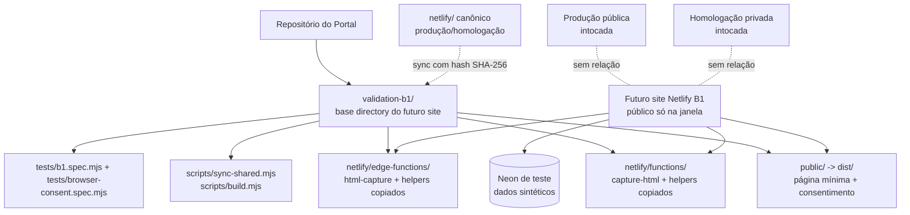

# Fase 5F.3.0 — Preparação local do ambiente público dedicado B1

Status: **preparação local concluída; nenhum site criado; nenhum deploy; nenhuma autorização remota consumida**.
Data: 2026-11-11.
Branch: `feat/portal-analytics`.
Commit de referência: `8d455fc4f01f7944f2a015681dd5c81c0704d786`.

A Fase 5F.3.1 **não** foi iniciada.

---

## 1. Resumo executivo

Foi criado um ambiente local isolado em `validation-b1/`, com:

- build próprio e independente (`dist/` com 6 arquivos publicados + `build-manifest.json`, ~10 KiB);
- página mínima de validação, sem calculadoras, anúncios, GA4 ou links afiliados;
- consentimento local mínimo com aceitar, recusar, retirar e recarregar;
- diagnóstico local sem segredos;
- cópias controladas da Edge Function, da Function de captura e dos helpers;
- script de sincronização com hash SHA-256 dos módulos canônicos;
- build que falha se encontrar segredos ou recursos externos no `dist/`;
- testes locais do B1, incluindo HMAC, nonce, payload, fail-open de navegação e ausência de
  requisições de navegador antes do consentimento.

**Resultado dos testes:**

- B1: **9/9** testes de build/HMAC + **2/2** testes de consentimento em navegador;
- raiz: **72/72** testes de analytics; 2 suítes PostgreSQL skipped por falta de `TEST_DATABASE_URL`;
- Playwright de consentimento da raiz: **11/11**;
- build B1: **6 arquivos publicados + `build-manifest.json`, 10,0 KiB**;
- nenhum segredo encontrado no `dist/` ou no diretório B1.

**Arquitetura:** site Netlify independente, base directory `validation-b1`, público somente durante a
janela autorizada, sem domínio do Portal, sem produção/homologação e com Neon de teste. B1 é
**público por definição**; `noindex` e `robots.txt` não são controle de acesso.

**Custo:** nenhum crédito consumido nesta fase. A futura criação do site deve caber no teto de 32
créditos e preservar 100 de reserva; saldo mínimo de início 132, a reconfirmar imediatamente antes da
5F.3.1. Deploys mínimos: 1 produção para criar o site (15) + branch deploys de teste (0), se previews
públicos forem possíveis; se não, 2 produção (30) e nenhum terceiro deploy de produção.

**Bloqueios:** o site B1 ainda não existe; o Site ID público, nome, domínio e visibilidade precisam
ser definidos e confirmados. As cópias do B1 estão locais e não commitadas; um deploy via Git exigirá
autorização futura de commit/push/PR. O bundler real, o rate limit interno, o runtime Edge e a
integração Neon continuam **NÃO COMPROVADOS**.

---

## 2. Estado atual do repositório

| Item | Valor |
|---|---|
| Diretório | `D:\Projetos\Site Calculadora` |
| Branch | `feat/portal-analytics` |
| Commit | `8d455fc4f01f7944f2a015681dd5c81c0704d786` |
| `git status --short` inicial | 258 entradas (fases anteriores preservadas) |
| `git status --short` após B1 | 259 entradas (`validation-b1/` não rastreado) |
| Estado final após este relatório | 260 entradas |
| Alterações funcionais no código de produção | Nenhuma |
| Alterações em `netlify.toml` raiz | Nenhuma |
| Alterações em `package.json` raiz | Nenhuma |
| Commit/push/PR | Nenhum |

O diretório `validation-b1/` é novo e não rastreado. A produção e a homologação privada não foram
alteradas. O código canônico em `netlify/` foi apenas lido e copiado; não foi editado.

---

## 3. Arquitetura do ambiente



### Princípios

- **Base directory** própria: `validation-b1/`.
- **Netlify config** própria: `validation-b1/netlify.toml`.
- **Publish** próprio: `validation-b1/dist`.
- **Functions** próprias: `validation-b1/netlify/functions`.
- **Edge Functions** próprias: `validation-b1/netlify/edge-functions`.
- **Dependências** próprias: `pg` e `zod` no `validation-b1/package.json`.
- **Sem** reaproveitar build, publish, variáveis ou secrets de produção/homologação.
- **Sem** páginas reais, calculadoras, AdSense, afiliados, GA4 ou conteúdo editorial.

---

## 4. Estrutura de diretórios

```text
validation-b1/
├─ .gitignore
├─ README.md
├─ netlify.toml
├─ package.json
├─ shared-manifest.json
├─ public/
│  ├─ index.html
│  ├─ validacao-encerrada.html
│  ├─ b1-consent.js
│  ├─ b1.css
│  ├─ robots.txt
│  └─ _headers
├─ netlify/
│  ├─ functions/
│  │  ├─ capture-html.mjs
│  │  └─ _lib/
│  │     ├─ capture-handler.mjs
│  │     ├─ capture-config.mjs
│  │     ├─ capture-validation.mjs
│  │     ├─ db.mjs
│  │     └─ http.mjs
│  └─ edge-functions/
│     ├─ html-capture.js
│     └─ _lib/
│        ├─ edge-capture.mjs
│        ├─ capture-policy.mjs
│        ├─ capture-limits.mjs
│        ├─ capture-signature.mjs
│        ├─ edge-env.mjs
│        └─ classifier.mjs
├─ scripts/
│  ├─ sync-shared.mjs
│  └─ build.mjs
├─ tests/
│  ├─ b1.spec.mjs
│  └─ browser-consent.spec.mjs
└─ dist/                 # gerado localmente, não versionar
```

`dist/` contém apenas o conteúdo de `public/` e o `build-manifest.json`; Functions e Edge não são
copiadas para `dist`.

---

## 5. Arquivos criados ou modificados

### Criados

- `validation-b1/netlify.toml`
- `validation-b1/package.json`
- `validation-b1/.gitignore`
- `validation-b1/README.md`
- `validation-b1/shared-manifest.json`
- `validation-b1/public/index.html`
- `validation-b1/public/validacao-encerrada.html`
- `validation-b1/public/b1-consent.js`
- `validation-b1/public/b1.css`
- `validation-b1/public/robots.txt`
- `validation-b1/public/_headers`
- `validation-b1/scripts/sync-shared.mjs`
- `validation-b1/scripts/build.mjs`
- `validation-b1/tests/b1.spec.mjs`
- `validation-b1/tests/browser-consent.spec.mjs`
- Cópias controladas em `validation-b1/netlify/**` (13 arquivos, listados no manifesto)
- `docs/analytics/fase-5f-3-0-preparacao-local-b1.md` (este relatório)

### Não modificados

- `netlify.toml` raiz
- `package.json` raiz
- `netlify/edge-functions/**` canônico
- `netlify/functions/**` canônico
- `js/analytics.js`
- `db/migrations/**`
- produção/homologação
- qualquer configuração remota

---

## 6. Estratégia de isolamento

### Isolamento de configuração

O futuro site B1 deve ser criado com **base directory `validation-b1`**. A Netlify lerá
`validation-b1/netlify.toml`, instalará `validation-b1/package.json` e publicará
`validation-b1/dist`. O `netlify.toml` raiz e o build do Portal não são usados pelo B1.

### Isolamento de Functions e Edge

- Functions: `validation-b1/netlify/functions`.
- Edge: `validation-b1/netlify/edge-functions`.
- As cópias usam a mesma estrutura relativa do código canônico, então os imports internos funcionam.
- `shared-manifest.json` guarda o SHA-256 de origem e cópia; o teste falha se houver divergência.
- O bundler real da Netlify ainda não foi executado; isso é uma validação futura.

### Isolamento de segredos

O B1 **não pode** usar `DATABASE_URL`, `EDGE_INGEST_SECRET` ou qualquer segredo de produção ou da
homologação privada. A configuração futura deve usar:

- um segredo `EDGE_INGEST_SECRET` novo, exclusivo do B1;
- um `DATABASE_URL` próprio, apontando para banco/branch/role de teste;
- configuração site-specific na Netlify, sem variáveis compartilhadas do time que possam injetar
  segredos de produção.

Se não for possível comprovar que não há variáveis compartilhadas/segredos de produção associados ao
site B1, **não criar/deployar**. O B1 não deve acessar o Neon de produção nem a role de produção.

### Remoção

Após a janela: flags `false`, deploy de encerramento (ou branch baseline), revogar o segredo B1,
remover o site/branch e confirmar que nenhuma linha foi gravada no Neon de produção. O site B1 é
público; todos os arquivos publicados devem ser seguros para exposição.

---

## 7. Página mínima e consentimento

### Página

- `/` é a única página de teste.
- `validacao-encerrada.html` é a página de encerramento.
- `meta robots` e `X-Robots-Tag` com `noindex, nofollow, noarchive`.
- `robots.txt` com `Disallow: /`.
- CSP restritiva, sem recursos externos, sem fontes externas, sem imagens externas.
- Nenhum formulário, input, calculadora, anúncio, afiliado ou GA4.
- Sem chamadas automáticas de `fetch`, `sendBeacon` ou `XMLHttpRequest`.

### Consentimento

`b1-consent.js` espelha a ponte existente:

- mesmo cookie `pca_edge_consent`;
- mesma versão `2026-11`;
- mesma chave local `pca_consent_v1`;
- `analytics=1` somente após ação explícita;
- `ads=0` sempre (B1 não tem publicidade);
- recusar grava `analytics=0`;
- retirar remove a preferência local e expira o cookie;
- DNT/GPC remove cookie positivo, desabilita “Aceitar” e informa o estado;
- “Recarregar para testar” é a única ação que gera nova navegação após o consentimento;
- nenhum ID de visitante/sessão é criado.

O cookie é preferência declarada, não prova criptográfica de consentimento. A página não registra
valores de formulário, IP bruto, UA bruto, cookie de autenticação ou dado pessoal.

---

## 8. Configuração de Edge e Function

### Function

- Arquivo: `validation-b1/netlify/functions/capture-html.mjs`.
- Rota: `/api/capture-html`.
- Mantém HMAC canônico, key-id, timestamp, nonce, limite de 8192 bytes, rate key, limite diário,
  validação de schema e ausência de IP/UA bruto no evento.
- `DATABASE_URL` e `EDGE_INGEST_SECRET` são lidos do ambiente do B1; nenhum valor fixo no código.
- Não há bypass de autenticação nem exceção de consentimento.

### Edge

- Arquivo: `validation-b1/netlify/edge-functions/html-capture.js`.
- `path: '/*'`, com as mesmas exclusões de assets/API.
- Mantém flags, escopo, GET/HTML, DNT/GPC, cookie, amostragem, classificação, HMAC do IP,
  limite de payload e assinatura canônica.
- `onError: 'bypass'` e `waitUntil` preservam a navegação.
- A Edge exclui `/api/*`, evitando recursão na chamada interna.

### Cópias compartilhadas

`sync-shared.mjs` copia exatamente 13 arquivos do código canônico; o teste compara SHA-256 de origem
e cópia. Alterações futuras no código canônico exigem `npm run sync:shared` no B1 antes do build.

### Rate limiting

**Nenhuma regra `rateLimit` foi adicionada ao B1 nesta fase.** Regras experimentais, se autorizadas,
serão adicionadas apenas no branch/site de validação em uma etapa futura. Não ativar em produção nem
na homologação privada.

---

## 9. Variáveis de ambiente futuras

Nenhum valor real foi criado ou copiado.

| Variável | Classificação | Uso no B1 | Observação |
|---|---|---|---|
| `EDGE_CAPTURE_ENABLED` | Configuração pública | Edge/Function | `false` por padrão; ativar só na janela |
| `EDGE_ANALYTICS_ENABLED` | Configuração pública | Edge/Function | `false` por padrão |
| `EDGE_INGEST_SECRET` | Segredo Edge/Function | HMAC e rate key | Novo valor exclusivo do B1; 32+ bytes UTF-8 |
| `EDGE_INGEST_KEY_ID` | Configuração não secreta | Assinatura | Ex.: `b1-v1` |
| `EDGE_ANALYTICS_SAMPLE_RATE` | Configuração operacional | Edge | `1` para teste controlado; `0.1` depois |
| `EDGE_CAPTURE_TIMEOUT_MS` | Configuração operacional | Edge | 250–5000; 2000 é hipótese |
| `EDGE_CAPTURE_MAX_EVENTS_DAY` | Configuração operacional | Function | Baixo no teste |
| `EDGE_CAPTURE_TIMESTAMP_WINDOW_SECONDS` | Configuração operacional | Function | 60 |
| `EDGE_CAPTURE_NONCE_TTL_SECONDS` | Configuração operacional | Function | 600 |
| `EDGE_RATE_MAX` | Configuração operacional | Function | Baixo no teste |
| `EDGE_RATE_WINDOW_SECONDS` | Configuração operacional | Function | 300 |
| `DATABASE_URL` | Segredo de servidor | Function | Banco/branch/role de teste; nunca produção |
| `DB_POOL_MAX` | Configuração operacional | Function | Opcional; 1 |
| `TEST_DATABASE_URL` | Segredo local/CI | Testes locais | Nunca configurar no site B1 remoto |

**Não usar no B1:** `CLEANUP_DATABASE_URL`, `MIGRATION_DATABASE_URL`, `RATE_LIMIT_HMAC_SECRET`,
`EDGE_SECURITY_ENABLED`, `ALLOWED_ORIGINS`, `HTML_CAPTURE_CLEANUP_ENABLED`. O B1 não inclui
Scheduled Function de limpeza; a limpeza do banco de teste é manual/controlada.

### Role Neon futura (proposta, não criada)

Propor uma role exclusiva de teste, por exemplo `analytics_b1_runtime`, com:

- `CONNECT` no banco de teste;
- `USAGE` no schema;
- `SELECT/INSERT/UPDATE` apenas nas tabelas da Fase 4;
- sem `DELETE`, sem DDL, sem acesso a tabelas das Fases 2/3, sem produção.

Não criar role, migration ou privilégio nesta fase. Se a role exclusiva não puder ser garantida,
não usar uma role de produção/homologação compartilhada; adiar o deploy.

---

## 10. Plano de deploy futuro

Nenhum comando abaixo foi executado. O site B1 **não existe** ainda.

### Pré-condições obrigatórias

| Alvo | ID histórico | Visibilidade | Uso no B1 |
|---|---|---|---|
| Homologação | `3da70f72-70f7-4883-b60b-25b430cc9270` | Privada | **Não usar** para B1 |
| Produção | `273101e3-7a01-4931-aeaf-4cee4fe74f07` | Pública | **Não tocar** |
| Neon de teste | `square-mountain-69641645` | — | Banco/branch de teste; confirmar |
| Site público B1 | **a definir** | Pública na janela | Criar/identificar na 5F.3.1 |

Confirmar simultaneamente:

- Site ID, nome, domínio e visibilidade do futuro site B1;
- que o Site ID não é `3da70f72-70f7-4883-b60b-25b430cc9270` (homologação privada) nem
  `273101e3-7a01-4931-aeaf-4cee4fe74f07` (produção);
- deploy atual de produção/homologação inalterado;
- saldo ≥132 créditos e teto 32;
- banco/branch/role Neon de teste;
- segredo B1 novo, não copiado;
- autorização para commit/push/PR (se deploy via Git) ou método de deploy manual autorizado;
- autorização para criar o site público.

### Configuração sugerida

- Nome: `portal-contas-b1-validacao` (sujeito a disponibilidade).
- Repositório: este repositório.
- Base directory: `validation-b1`.
- Build command: `node scripts/build.mjs`.
- Publish directory: `dist` (relativo ao base).
- Functions: `netlify/functions`.
- Edge Functions: `netlify/edge-functions`.
- Visibilidade: **pública** somente durante a janela de teste.
- Domínio: subdomínio `*.netlify.app`; **não** usar domínio do Portal.
- Conteúdo: apenas `validation-b1/public` (sintético).
- Variáveis: site-specific, conforme seção 9; flags `false` no baseline.
- Rate limit: nenhum no baseline; regras experimentais só em branch de teste.

### Sequência com o menor número de deploys

| # | Ação futura | Deploy | Custo estimado | Resultado esperado |
|---|---|---|---:|---|
| 1 | Criar site B1 público com flags `false`, sem rate limit, base `validation-b1` | 1 produção | 15 | Página 200; nenhuma captura; zero Function/Neon |
| 2 | Criar branch de teste com flags `true`, amostra 1, banco de teste | 1 branch | 0 (se preview público) | Edge → Function 202; evento sintético no Neon |
| 3 | Criar branch com rate limit experimental | 1 branch | 0 | 429 no limite; sem bloquear legítimos; IP documentado |
| 4 | Encerrar: voltar ao baseline/flag `false` | branch baseline | 0 | Zero novas capturas; página 200 |
| 5 | Remover site/branch e revogar segredo | — | 0 | Nenhum resquício público |

Se o branch/Deploy Preview não puder ser público, o teste B1 não funciona como planejado; nesse caso,
não usar 3 deploys de produção (45 créditos, acima do teto). Alternativas: autorizar 2 produção
(30) ou mudar para C. **Não** tornar a homologação privada pública.

### Verificação

- Site ID/nome/domínio/visibilidade conferidos antes de cada deploy.
- Página `/` 200 e `noindex`.
- `robots.txt`, CSP, `_headers` e página de encerramento.
- Nenhuma requisição de navegador antes do consentimento.
- Com flags `false`: nenhuma Function, nenhuma linha no Neon.
- Com flags `true`: Edge → Function 202; uma linha sintética por evento aceito.
- HMAC/replay/timestamp/key-id/payload/fail-open conforme a matriz da Fase 5F.2.
- Nenhum segredo no `dist`, nos logs ou nas respostas.
- Custo medido e dentro do teto.

---

## 11. Orçamento estimado

Saldo confirmado pelo usuário: **≥132 créditos**; teto **32**; reserva **100**. O saldo não foi
consultado nesta fase. A confirmação não autoriza gasto.

### Deploys

| Cenário | Deploys | Custo |
|---|---|---:|
| Site B1 já existente + previews públicos | 2–3 branch deploys | 0 |
| Criar site B1 + branch deploys públicos | 1 produção + 2–3 branches | 15 |
| Sem preview público; usar produção | 2 produção no máximo | 30 |
| 3 produção | não recomendado | 45 (acima do teto) |

### Uso de teste recomendado

| Item | Limite |
|---|---|
| Páginas de teste | 100–300 |
| Capturas válidas | 50–100 |
| POSTs inválidos | 1.000–5.000 |
| Custo de uso estimado | < 5 créditos |
| Custo total típico | 15–20 créditos com site novo; < 5 se branches |
| Teto | 32 créditos |
| Interrupção | >32 ou saldo restante <100 |
| Adiamento | saldo <132, ciclo no fim ou produção consumindo rápido |

### Referência de volume (fórmulas da Fase 5F.2)

- 1.000 páginas/dia ≈ 7,02 créditos/mês.
- 10.000 páginas/dia ≈ 70,17 créditos/mês.
- 100.000 páginas/dia ≈ 701,67 créditos/mês.
- 1.000.000 páginas/dia ≈ 7.016,67 créditos/mês.
- 1.000 POSTs inválidos/dia que chegam à Function ≈ 10,17 créditos/mês.
- 10.000 POSTs inválidos/dia ≈ 101,67 créditos/mês.
- 100.000 POSTs inválidos/dia ≈ 1.016,67 créditos/mês.

O 429 de rate limit pode ou não contar como web request; a documentação não explicita. Orçar
conservadoramente. A fonte das tarifas e a memória de cálculo completa estão na Fase 5F.2.

---

## 12. Testes executados

| Teste | Resultado | Aprovados | Falhas | Ignorados |
|---|---|---:|---:|---:|
| `validation-b1/npm run test:all` | PASS | 9 + 2 browser | 0 | 0 |
| `validation-b1/npm run test:browser` | PASS | 2 | 0 | 0 |
| `validation-b1/npm run build` | PASS | 6 publicados + manifest/10,0 KiB | 0 | 0 |
| `npm run test:analytics` (raiz) | PASS | 72 | 0 | 2 suítes PostgreSQL |
| `npx playwright test tests/e2e/consent.spec.js` | PASS | 11 | 0 | 0 |
| Hash das 13 cópias compartilhadas | PASS | 13 | 0 | 0 |
| Scan de segredos/recursos externos no `dist` | PASS | — | 0 | 0 |

Cobertura B1: cópias idênticas ao canônico, página mínima/noindex, consentimento sem rede
(estático e em navegador local), headers/robots, build independente, configs de rota, captura da
página raiz, payload sem IP/UA, status 202, limite de payload, HMAC inválido, nonce divergente,
flags falsas e segredo ausente. O teste de navegador usa o Playwright já instalado na raiz; ele não
é uma dependência de runtime do site B1.

### Não executados

- Edge e Function reais na Netlify (exigem site/deploy).
- Rate limiting real e IP da chamada interna.
- Replay/HMAC contra PostgreSQL real (exigem `TEST_DATABASE_URL`).
- `waitUntil`, `AbortSignal`, WebCrypto, CPU, cold start e bundler reais.
- Latência Ohio → São Paulo e falha de Neon.
- Consentimento da página B1 em navegador real foi validado localmente (2 testes Playwright); não
  foi testado no domínio Netlify real.
- Qualquer POST/GET remoto.

---

## 13. Riscos residuais

1. **Site B1 não existe**: ID, nome, domínio, visibilidade e deploy precisam ser definidos.
2. **Cópias locais não commitadas**: deploy via Git exige commit/push/PR autorizado; sem isso, o site
   não terá o B1.
3. **Isolamento de segredos**: variáveis compartilhadas do time podem existir; verificar antes do
   deploy. Se não houver garantia, não deployar.
4. **B1 é público**: `noindex` não é controle de acesso; qualquer arquivo publicado deve ser seguro.
5. **Bundler real**: o build local não empacota Functions/Edge; imports e `_lib` podem falhar no
   deploy.
6. **Rate limit interno**: IP/reaplicação continuam NÃO COMPROVADOS; não ativar regra na Function
   sem teste.
7. **Runtime**: CPU 50 ms, `waitUntil`, `AbortSignal`, WebCrypto, cold start e timeout de 2000 ms
   não medidos.
8. **Neon**: role/branch de teste não criados; sem cleanup automático no B1; limpeza manual.
9. **Custo**: saldo e consumo reais não consultados; 15–32 créditos é estimativa.
10. **Consentimento**: cookie é preferência do cliente, não prova; não usar para autenticação.
11. **Produção/homologação**: qualquer comando que use Site ID errado é risco crítico; confirmação
    simultânea de ID/nome/domínio/visibilidade/deploy é obrigatória.

---

## 14. Operações que exigirão nova autorização

- Criar o site público B1 na Netlify.
- Definir visibilidade pública e domínio `*.netlify.app`.
- Configurar variáveis/secrets site-specific e flags.
- Criar/identificar banco, branch e role Neon de teste.
- Commit/push/PR do diretório `validation-b1` ou autorização de deploy manual.
- Fazer deploy de criação, branch de teste, rate limit experimental e encerramento.
- Executar qualquer Function/Edge Function remota.
- Executar POST/GET remoto.
- Ativar rate limiting no site B1.
- Escrever dados sintéticos e limpar o Neon de teste.
- Gastar até 32 créditos e aceitar a reserva de 100.
- Iniciar a Fase 5F.3.1.

---

## Fontes consultadas

Consultadas em **2026-11-11**.

1. Netlify — Rate limiting.
   https://docs.netlify.com/manage/security/secure-access-to-sites/rate-limiting/
2. Netlify — Request Chain.
   https://docs.netlify.com/resources/troubleshooting/request-chain/
3. Netlify — Edge Functions declarations.
   https://docs.netlify.com/build/edge-functions/declarations/
4. Netlify — Functions API reference.
   https://docs.netlify.com/build/functions/api/
5. Netlify — Configuration for functions.
   https://docs.netlify.com/build/functions/configuration/
6. Netlify — Edge Functions API.
   https://docs.netlify.com/build/edge-functions/api/
7. Netlify — How credits work.
   https://docs.netlify.com/manage/accounts-and-billing/billing/billing-for-credit-based-plans/how-credits-work/
8. Netlify — Netlify Blobs.
   https://docs.netlify.com/build/data-and-storage/netlify-blobs/
9. Netlify — Project visibility.
   https://docs.netlify.com/manage/security/secure-access-to-sites/project-visibility/
10. Neon — Regions.
    https://neon.com/docs/introduction/regions
11. Neon — Plans.
    https://neon.com/docs/introduction/plans

## Confirmação de estado

- Nenhum site criado na Netlify.
- Nenhum deploy realizado.
- Nenhum branch deploy criado.
- Nenhum push ou commit.
- Nenhuma configuração remota alterada.
- Nenhuma variável remota alterada.
- Nenhuma flag ativada.
- Nenhuma regra de rate limiting criada.
- Nenhuma Function ou Edge Function executada remotamente.
- Nenhum POST ou GET remoto.
- Nenhuma escrita no Neon.
- Nenhuma migration ou role alterada.
- Nenhum serviço pago contratado.
- Produção e homologação intactas; visibilidades inalteradas.
- Nenhuma credencial exibida.

A Fase 5F.3.1 — criação do site B1 e validação remota — **não** deve começar automaticamente.
Aguardar autorização explícita do usuário.
